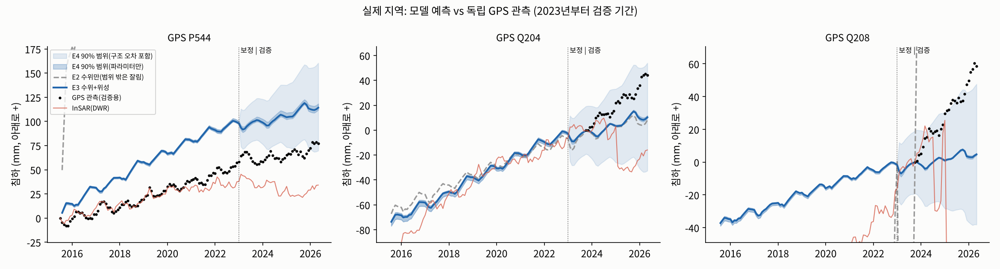
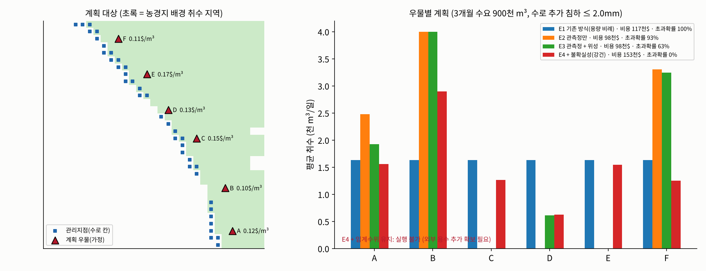
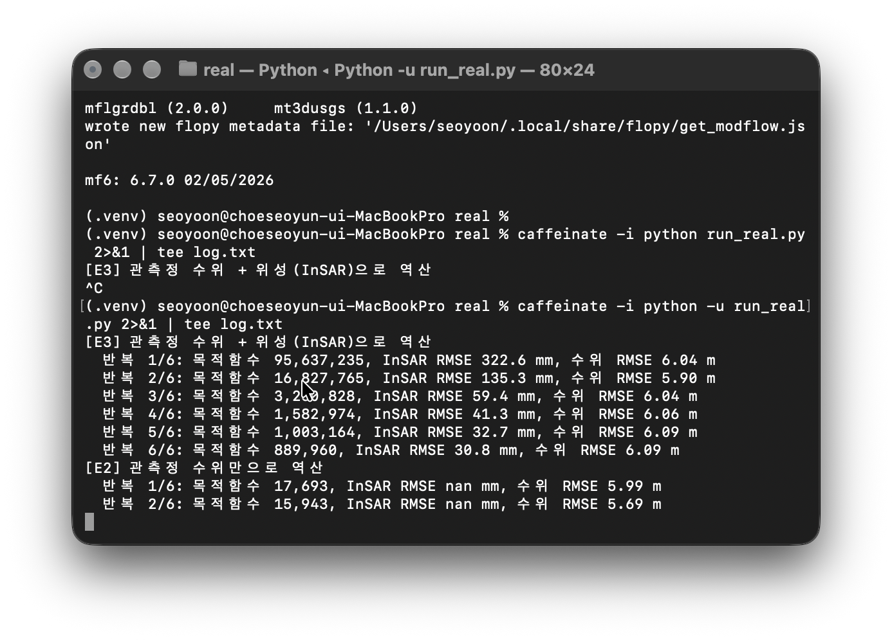

# AquaLimit 진행 정리

> 실제 지역(캘리포니아 Lost Hills 주변 수로 구간)의 실제 위성·관측 자료로 지하수 물리모델을 만들었고, 보정에 쓰지 않은 GPS로 채점했다. 첫 번째 모델에서 위성을 넣으면 예측 오차가 약 47cm에서 2cm로 줄었다.

## 오늘 말할 것

1. 가상 땅 실험을 더 어렵게 바꿔서 다시 확인했다
2. 실제 지역을 정하고 실제 자료로 물리모델을 만들었다
3. 보정에 안 쓴 GPS로 채점했다 → **위성을 넣으면 오차 47cm → 2cm** (첫 번째 모델)
4. 그 모델로 취수 계획, 날씨 시나리오, AI 대리모델까지 만들었다 (계획은 계획에 안 쓴 땅속 상태로 다시 채점)
5. 새 버전: 온도·위성으로 취수량 추정 → 위성 침하를 넣으면 좋아진다는 결론은 그대로, 불확실성 범위는 넓어짐

---

## 1. 지금까지 한 것 (요약)

| 단계 | 한 일 | 결과 |
|---|---|---|
| 가상 데이터 데모 | 가상 관정 4개로 "어느 관정에서 얼마나 뽑을지" 계산 화면 | 불확실성 반영, 실행 불가 판정까지 동작 |
| 가상 땅 실험 ① | 정답을 아는 가상 땅 10개에서 E1~E4 비교 | 위성을 넣으면 땅속 추정 오차 41% → 2.9% |
| 가상 땅 실험 ② | 정답 땅을 실제 물리모델(MODFLOW)로 교체 | 이번 발표 2절 |
| **실제 지역** | 실제 자료로 물리모델, GPS로 검증 | **이번 발표 3~7절** |

비교한 네 방식은 그대로다.

| 방식 | 쓰는 자료 |
|---|---|
| E1 기존 계획 | 없음. 관정 용량대로 나눠 뽑음 |
| E2 지상 관측만 | 관측정 수위 |
| E3 위성 + 추정값 1개 | 수위 + 위성 침하 |
| E4 위성 + 불확실성 | 수위 + 위성 침하, 가능한 땅속 상태 30개 전부 사용 |

---

## 2. 가상 땅 실험을 더 어렵게: 정답 땅을 물리모델로 교체

**왜:** 지난번 실험은 문제를 만든 공식과 푸는 공식이 같아서 너무 쉬웠다.
**바꾼 것:** 정답 땅만 실제 물리모델(MODFLOW 6 + 침하 계산 CSUB)로 바꿨다. 층 2개, 누수, 영구 침하가 들어 있다. 푸는 쪽은 여전히 단순한 공식이다.

| | E2 | E3 | E4 |
|---|---|---|---|
| 6개월 뒤 침하 예측 오차 | 5.14mm | 3.19mm | 3.19mm |
| 예상한 침하와 실제(정답 땅) 침하의 차이 | +0.39mm | +0.21mm | **+0.02mm** |

- 위성을 넣으면 예측이 좋아진다(5.14 → 3.19mm).
- E2·E3는 10번 모두 예상보다 더 꺼졌다. **E4는 평균적으로 예상과 거의 같았다**(+0.02mm, 10번 중 5번은 예상보다 조금 더, 5번은 덜 꺼짐).
- 다만 E4도 10번 중 4번 기준을 넘었다. 단순한 공식으로 복잡한 땅을 계획한 한계다. → 실제 지역에서는 **계획하는 쪽도 물리모델로** 바꿨다.

> "정답 땅을 실제 물리모델로 바꿔서 문제를 더 어렵게 만들었습니다. 그래도 위성을 넣으면 예측이 좋아졌고, 불확실성을 반영한 E4만 예상과 실제가 평균적으로 맞았습니다."

---

## 3. 실제 지역: 캘리포니아 수로 MP 195~215 주변

**왜 여기인가**
- 지하수 때문에 땅이 꺼져 **주정부 수로(California Aqueduct)가 실제로 손상**되고 있다.
- 필요한 자료 세 가지(위성 침하, 관측정 수위, 지층 구조)를 **모두 공개 자료로 바로 받을 수 있는 유일한 후보**였다. 대만, 멕시코시티, 자카르타, 국내와 비교했다.
- 채점용 GPS도 있다.

**범위:** Lost Hills 주변 약 32km × 31km, 1km 칸 32 × 31개

**왜 한 지역만 하나:** 정답지(GPS)가 있는 곳에서 먼저 "진짜 맞는지" 채점하기 위해서다. 신약을 한 병원에서 먼저 임상시험하는 것과 같다. 방법 자체는 위성·관측정·지층 자료만 있으면 다른 지역에도 그대로 쓸 수 있고, 지역을 넓히는 것은 다음 단계다.

**받은 자료**

| 자료 | 출처 | 양 | 용도 |
|---|---|---|---|
| 위성 침하(InSAR) | 캘리포니아 수자원국(DWR) | 측정점 74,944개, 2015~2026 월별 | 보정 |
| 관측정 수위 | DWR | 30곳, 1,831건 | 보정·검증 |
| GPS | 네바다대 측지연구소 | 수로 옆 5곳 | **채점 전용** |
| 지층 구조 | USGS CVHM2 | 13개 층, 모래·점토 비율 | 모델 층 |
| 강수 | NOAA 관측소 2곳 | 월 강수 | 함양, 가뭄 |

**자료로 본 현재 상태 (유전 제외)**

| | 값 |
|---|---|
| 수로 2km 안 침하 속도 | 중앙값 **연 15mm**, 가장 심한 곳 연 38mm |
| 2015년부터 누적 | 중앙값 60mm, 가장 심한 곳 **256mm** |

### 이 지역의 물 사정: 누가, 어떻게 물을 쓰나

| | 내용 |
|---|---|
| 누가 | 피스타치오·아몬드 같은 대규모 과수원. 물 공급구역 3곳(Lost Hills, Belridge, Berrenda Mesa)이 모인 **지하수 관리기관(WDWA)**이 관리한다 |
| 평소 | **수로 물**을 쓴다. 바로 이 California Aqueduct로 북쪽 물이 내려온다(계약량 연 약 4억 1천만 톤) |
| 지하수 | 짠물이라 품질이 나빠 평소엔 적게 쓴다 |
| 가뭄 해 | 주정부가 수로 물을 적게 준다(2021·2022년 계약량의 **5%**). 모자란 만큼 **관정(지하수 펌프 시설, 깊이 150~250m)**으로 지하수를 뽑는다 → 땅이 꺼진다 |
| 지금 | 관리기관이 **수로 MP 195~215 양쪽 4km 안 지하수 취수를 전면 금지**했다(어기면 벌금). 그러면서도 "침하가 지하수 때문인지 증명할 자료가 없다"고 했다 |

악순환: 수로 물이 부족 → 지하수를 뽑음 → 땅이 꺼짐 → 수로가 휘어 물을 더 못 보냄 → 다음 가뭄에 또 지하수

> "자료가 모두 공개돼 있고, 침하가 실제로 국가 기반시설을 망가뜨리고 있는 곳이라 골랐습니다. 수로 주변은 지금도 1년에 15mm씩 가라앉고 있고, 관리기관은 원인을 모른 채 취수를 전면 금지한 상태입니다."

---

## 4. 자료를 열어 보니 문제가 세 가지 있었다

| 문제 | 무엇이 문제인가 | 어떻게 했나 |
|---|---|---|
| ① 유전 침하가 섞여 있다 | 수로 주변 칸의 **39%**가 유전 안이다. 석유를 뽑아 생긴 침하를 지하수 때문이라고 착각하면 과대추정한다 | 유전 칸은 계산에서 뺐다 |
| ② 수로 옆 관측정은 최근에 생겼다 | 수로 바로 옆 관측정은 2023~2025년 설치. 오래된 관측정은 5~9km 떨어져 있다 | 과거 기간은 위성이 더 중요해진다 |
| ③ 최근 위성 자료가 GPS와 안 맞는다 | 2022년까지는 잘 맞았다. 2023년 이후 위성은 "땅이 올라간다", GPS는 "계속 꺼진다" | 2023년 이후 위성 자료는 빼고, 그 기간은 GPS로 채점 |

> "공개 자료를 그대로 쓰면 틀립니다. 유전 침하를 걸러내고, 위성 자료도 GPS로 교차 확인하는 '자료 품질 검사'가 서비스의 한 기능이 돼야 한다는 걸 알게 됐습니다."

---

## 5. 실제 지역 물리모델과 보정

**모델:** MODFLOW 6 + CSUB(미국 지질조사국 지하수·침하 계산 프로그램)
- 층: USGS CVHM2의 13개 층을 4개로 묶음(상부 대수층 / 코코란 점토 / 하부 대수층 위·아래)
- 칸마다 모래·점토 비율로 물이 통하는 정도와 점토가 눌리는 정도를 계산
- 과거 최저 수위보다 내려가면 **영구 침하**

**지하수 취수는 어떻게 넣었나:** 이 지역에서 지하수를 뽑는 건 거의 농장뿐이다. 도시·공장은 거의 없고, 유전은 석유와 함께 나온 물을 다시 주입하며 유전 구역은 계산에서 뺐다. 그래서 "농장이 얼마나 뽑았나 = 지하수를 얼마나 뽑았나"다. 농장별 실제 취수 기록은 비공개라 추정한다(첫 번째 모델은 농경지 전체에 고르게, 8절 새 버전은 위성 자료로).

### 왜 역산(보정)을 하나: 땅속은 직접 잴 수 없다

땅이 얼마나 꺼질지는 땅속 점토가 얼마나 잘 눌리는지에 달려 있다. 그런데 이걸 지역 전체에서 직접 잴 방법이 없다. 재려면 수백 m를 뚫어 흙을 꺼내 실험해야 하고, 그래도 **뚫은 한 점**만 안다.

대신 땅 위에서 **결과**는 보인다. 위성은 땅이 몇 mm 꺼졌는지, 관측정은 땅속 물 높이를 보여준다. 그래서 **결과를 보고 원인을 거꾸로 찾는다.** 이것이 역산이다.

| | 방향 | 예 |
|---|---|---|
| 보통 시뮬레이션 | 원인 → 결과 | "점토가 이만큼 잘 눌리고 물을 이만큼 뽑으면 → 50mm 꺼진다" |
| **역산** | 결과 → 원인 | "실제로 50mm 꺼졌으니 → 점토가 이만큼 잘 눌리는 거다" |

병원 CT가 몸을 열지 않고 몸속을 알아내듯, **위성이 땅의 CT 역할**을 한다.

### 이미 있는 값은? → 출발점으로 쓴다

- USGS CVHM2(센트럴밸리 전체 지하수 모델)에 칸마다 점토 두께, 모래 비율, 압축 계수가 있다. **이 값을 그대로 가져와 출발점으로 쓴다.**
- 그런데 CVHM2는 센트럴밸리 전체(약 5만 km²)를 맞춘 값이라 우리 30km 지역에 딱 맞지 않는다. 얼마나 뽑았는지(취수량)는 아예 없다.
- 그래서 CVHM2 값에 구역별 **보정 배수**를 곱해 조정한다(처음엔 1배). 첫 번째 모델 결과를 보면 같은 CVHM2 값인데도 구역마다 맞는 배수가 **0.07배~1.25배**로 크게 달랐다. 기존 값만 썼으면 크게 틀렸을 것이다.

### 누가 찾나 → 컴퓨터가 자동으로

| 사람이 정하는 것 | 컴퓨터가 하는 것 |
|---|---|
| 어떤 값을 찾을지(15개, 새 버전 17개) | 값을 조금 바꿔 시뮬레이션 → 위성과 비교 → 더 맞는 쪽으로 고치기를 반복 |
| 어디서 시작할지(CVHM2) | 차이가 더 안 줄 때까지(6번 반복) |

방법: 비선형 최소제곱(가우스-뉴턴 / 레벤버그-마쿼트). 수학적으로는 비선형 회귀와 같은 계산이다.

### 머신러닝인가? → 아니다. 물리모델 보정이다

| | 물리모델 보정 (지금 하는 것) | 머신러닝 |
|---|---|---|
| 규칙 | **물리 법칙**(물 흐름, 점토 압축)이 정해져 있음 | 규칙을 자료에서 스스로 배움 |
| 찾는 값 | 15~17개, 전부 의미 있음 | 수천~수백만 개, 각각 의미 없음 |
| 필요한 자료 | 적어도 됨(물리 법칙이 채워줌) | 아주 많이 필요 |
| 결과 설명 | "이 구역 점토는 평균보다 0.7배 덜 눌린다"처럼 설명 가능 | 설명하기 어려움 |

이 지역은 관측이 적어서(관측정 30곳, GPS 5곳) 머신러닝만으로는 학습 자료가 부족하다. 머신러닝은 물리모델을 빠르게 흉내 내는 **AI 대리모델(7절 ③)**에 썼다.

> "땅속은 직접 잴 수 없어서, 위성이 본 침하를 보고 땅속 성질을 거꾸로 찾았습니다. USGS의 기존 값에서 출발해 이 지역 위성 관측에 맞게 컴퓨터가 자동으로 조정했습니다. 학습이 아니라 보정이라서, 결과를 물리적으로 설명할 수 있습니다."

### 보정과 검증

**보정:** 모르는 값을 바꿔 가며 시뮬레이션을 반복해 **과거 실제 관측(2015~2022 위성·관측정)과 가장 잘 맞는 값**을 찾는다.

**검증이란:** 보정에 **한 번도 안 쓴 2023~2026 GPS**로 채점한다. 

| 기간 | 쓰는 자료 | 역할 |
|---|---|---|
| 2015.7~2022.12 | 위성 + 관측정 | 보정(공부) |
| 2023.1~2026.4 | GPS + 관측정 | 검증(시험) |

> "모델 안에 모르는 값 15개를 과거 위성 자료에 맞춰 찾았습니다. 그리고 보정에 전혀 쓰지 않은 최근 3년치 GPS로 채점했습니다."

---

## 6. 검증 결과 (첫 번째 모델): 위성을 넣으면 오차 47cm → 2cm

| 방식 | GPS 침하 오차 | 관측정 수위 오차 |
|---|---|---|
| E2 관측정만 | 466.7mm | 14.75m |
| **E3 관측정 + 위성** | **20.5mm** | 2.92m |
| E4 + 불확실성 | 20.6mm | 2.95m |

| E4가 "90% 확률로 이 범위"라고 한 범위에 실제 GPS가 들어간 비율 | |
|---|---|
| 처음 | 31% |
| 모델 구조 오차까지 반영 | **94%** (평균 폭 65mm) |

- 가상 땅에서 본 결과가 **실제 땅에서도 같은 방향으로** 나왔다.
- 불확실성 범위의 GPS 포함률이 목표(90%)에 가깝게 나왔다. 다만 GPS 5곳의 월별 값이라 서로 비슷한 자료가 많아서, 확실한 증명이라기보다 첫 확인이다.
- 한계: 수로 남쪽의 최근 침하 가속은 실제보다 작게 예측했다.
- 이 절은 취수를 "농경지 전체에 고르게" 둔 **첫 번째 모델** 결과다. 7절 계획·날씨·AI도 이 모델로 만들었다. 온도·위성 취수를 넣은 새 모델 결과는 8절에 있다.

> "관측정만으로는 47cm를 틀렸고, 위성을 넣으니 2cm로 줄었습니다. 보정에 쓰지 않은 GPS로 채점한 결과입니다."

---

## 7. 이 모델로 만든 것 (첫 번째 모델 기준)

### ① 취수 계획

3개월 동안 90만 톤 필요, 수로 주변이 2mm 넘게 더 꺼지면 안 됨. (관정 6개 위치·비용은 설명용 가정)

| 방식 | 비용 | 기준 초과 (계획에 쓴 30개) | **기준 초과 (계획에 안 쓴 새 30개)** | 실제 땅이 25% 더 반응하면 |
|---|---|---|---|---|
| E1 기존 방식 | 11.7만$ | 100% | **100%** | 100% |
| E2 관측정만 | 9.8만$ | 93% | **90%** | 100% |
| E3 관측정 + 위성 | 9.8만$ | 63% | **60%** | 100% |
| **E4 + 불확실성** | 15.3만$ | 0% (정의상) | **0%** (30개 중 0개) | 87% |

- E4 계획을 새 30개 각각에 **MODFLOW로 직접** 넣어 돌려도 기준 초과 0개였다. 최대 추가 침하는 평균 1.72mm, 가장 나쁜 경우 1.94mm(기준 2mm).

- **"계획에 쓴 30개" 열의 E4 0%는 정의상 0%다.** E4 계획은 바로 그 30개 모두에서 기준을 지키도록 만든 것이라, 같은 30개로 채점하면 당연히 0%가 나온다(시험 문제를 보고 답을 만든 뒤 같은 문제로 채점한 셈).
- 그래서 **계획에 안 쓴 땅속 상태 30개를 새로 뽑아 다시 채점**한다. E4 계획은 그 30개 각각에 MODFLOW로 직접 넣어서도 확인한다.
- **읽는 법:** 30개 중 0개는 "위험이 0"이 아니라 "이 모델 안에서 위험이 낮다(통계적으로 대략 10% 미만)"는 뜻이다.
- **가장 중요한 한계:** 실제 땅이 모델보다 25%만 더 반응해도 E4가 87% 확률로 기준을 넘는다. E4는 기준선(2mm) 바로 아래에 맞춰 비용을 아끼는 계획이라 여유가 작다. 모델 구조 오차를 계획에 직접 넣어 여유를 정하는 것이 다음 과제다.
- 과거 최저 수위까지 지키라는 조건을 넣으면 **"실행 불가"**다. 이 사업자가 관정을 하나도 안 돌리고 물을 **전부 외부에서 사도** 못 지킨다. 다른 농가 취수만으로 이미 수위가 과거 최저보다 낮기 때문이다. → **지역 관리기관 단위의 서비스가 필요하다.**

### ② 날씨 시나리오

비는 함양으로, 가뭄은 "다른 농가가 더 뽑는다"로 반영했다(첫 번째 모델에는 온도가 없다. 8절에서 추가).

| 계획 | 비용 | 습한 해 | 평년 | 가뭄 해 |
|---|---|---|---|---|
| 평년 기준 계획 | 15.3만$ | 0% | 0% | **43%** |
| 세 시나리오 모두 고려 | 21.1만$ | 0% | 0% | 0% |

| 계획에 안 쓴 새 30개로 다시 채점 | 습한 해 | 평년 | 가뭄 해 |
|---|---|---|---|
| 평년 기준 계획 | 0% | 0% | **50%** |
| 세 시나리오 모두 고려 | 0% | 0% | 0% |

가뭄을 생각하지 않은 계획은 가뭄 해에 **43~50%** 확률로 기준을 넘는다(계획에 쓴 30개 43%, 새 30개 50%). 세 날씨를 모두 고려하면 비용이 38% 더 들지만 새 30개에서도 0%다.

### ③ AI 대리모델

불확실성을 제대로 보려면 1,000번 계산해야 하는데, 물리모델로는 약 14.5시간이 걸린다.

| | 물리모델 | AI |
|---|---|---|
| 1회 계산 | 7.5초 | 0.00007초 (약 11만 배) |
| 1,000회 | 약 14.5시간 | 0.1초 |
| 정확도 | - | 오차 0.14mm, R² 0.997 |

물리모델 결과 600개로 학습시켰다. AI 오차만큼 기준을 낮춰 계획하면, 그 계획을 물리모델(E4 30개)로 다시 확인해도 기준 초과 0%다.

> "물리모델로 14시간 걸리는 계산을 AI로 0.1초에 합니다. 그래서 담당자가 화면에서 조건을 바꿔 가며 바로 계획을 볼 수 있습니다."

---

## 8. 새 버전: 온도와 위성으로 취수량 추정

교수님 지적("너무 단순하다", "온도는?")과 "취수량이 가정"이라는 약점을 고치는 작업이다.

### 무엇을 바꿨나

| | 첫 번째 모델 | 새 버전 |
|---|---|---|
| 어디서 뽑나 | 농경지 전체에 **똑같이** | **Landsat 위성**으로 본 밭마다 다르게(푸른 과수원은 많이, 빈 땅은 적게) |
| 언제 많이 뽑나 | 농사철에 1.6배 (**정한 값**) | **기온·습도·바람·햇빛으로 계산한 증발산량**대로. 덥고 건조할수록 많이 |
| 가뭄 해 | 비가 적으면 더 | **주정부 수로 물 배분율**대로. 수로 물이 모자란 만큼 지하수 |
| 온도 | 없음 | **들어감** |
| 위성으로 설명 안 되는 나머지 | - | 첫 번째 모델의 균일·계절·가뭄 취수 항을 남겨 두고 크기를 보정 |

계산식: 작물이 쓴 물 = 위성으로 본 초록 정도(NDVI) × 기상자료로 계산한 증발산량(NASA가 캘리포니아에서 쓰는 SIMS 방식). 여기서 비와 수로 물을 빼고 모자란 만큼을 지하수 취수로 본다. 이것으로 설명되지 않는 나머지 취수는 첫 번째 모델 방식의 항으로 두고 보정으로 크기를 찾는다.

정확한 한 줄: **위성·기상·수로 배분율 자료로 취수를 추정하고, 설명되지 않는 나머지는 보정했다.**

> "온도가 오르면 작물이 물을 더 쓰고, 지하수를 더 뽑고, 땅이 더 꺼집니다. 이 연결을 위성 자료로 모델에 넣었습니다."

### 다시 보정하는 과정

취수 방식이 바뀌면 전에 찾은 땅속 성질 값이 더 이상 맞지 않아서, 처음부터 다시 보정한다.

**화면 읽는 법**

| 화면 | 뜻 |
|---|---|
| `[E3] 관측정 수위 + 위성(InSAR)으로 역산` | 위성과 관측정으로 모르는 값 17개를 찾는 중 |
| `반복 1/6 … 6/6` | 값을 고쳐 가며 시뮬레이션을 반복한 횟수 |
| `목적함수` | 시뮬레이션과 실제 관측의 차이를 합친 점수. **작을수록 잘 맞음** |
| `InSAR RMSE` | 위성으로 잰 침하와 시뮬레이션의 평균 차이 |
| `수위 RMSE` | 관측정 수위와 시뮬레이션의 평균 차이 |
| `[E2] 관측정 수위만으로 역산` | 비교용. 위성 없이 같은 작업 |

**보정 과정 결과 (E3, 보정 기간)**
- 반복할수록 위성 침하 차이가 **322.6mm → 30.8mm**로 줄었다(첫 번째 모델 30.1mm와 비슷).

> "화면은 컴퓨터가 땅속 성질 값을 고쳐 가며 과거 위성 관측에 맞추는 과정입니다. 처음엔 32cm 차이가 났는데 여섯 번 반복해서 3cm까지 줄였습니다."

### 새 버전 채점 결과 (보정에 안 쓴 GPS)

| GPS 침하 오차 | 첫 번째 모델 (취수 균일 가정) | 새 버전 (위성·온도로 취수 추정) |
|---|---|---|
| E2 관측정만 | 466.7mm | **59.2mm** |
| E3 관측정 + 위성 침하 | 20.5mm | 25.2mm |
| E4 + 불확실성 | 20.6mm | 23.7mm |
| E4 90% 범위가 GPS를 포함한 비율 | 94% (평균 폭 65mm) | 100% (평균 폭 **265mm**) |

**해석**
1. **위성 침하(InSAR)를 넣으면 여전히 좋아진다:** 59.2mm → 25.2mm
2. **새 취수 추정 방식에서는 관측정만 쓴 방식의 오차도 줄었다(466.7 → 59.2mm).** 다만 두 버전은 Landsat만 다른 게 아니라 기상(증발산), 수로 배분율, 취수 파라미터가 함께 바뀌었다. 그래서 "Landsat 덕분"이라고는 아직 말할 수 없다. Landsat의 기여를 확인하려면 나머지는 그대로 두고 Landsat만 빼 보는 실험이 필요하다(다음 단계).
3. **가장 좋은 방식의 정확도는 첫 번째 모델과 비슷하거나 조금 나쁘다(20.5 → 25.2mm).**
4. **불확실성 범위는 오히려 나빠졌다.** 100% 포함은 범위가 265mm로 너무 넓어서 나온 숫자라 "믿을 수 있다"는 뜻이 아니다. 2019년까지만으로 보정해 2020~2022 대가뭄을 예측하게 하면 잘 못 맞힌다. 함양 비율(비의 70%가 스며듦)처럼 현실과 먼 값도 나왔다. 모델이 다른 부족한 부분을 이 값으로 메우고 있다는 신호다. 수로 남쪽(Q204·Q208)의 최근 침하도 여전히 작게 예측한다.

**그래서:** 6절 검증과 7절 계획·날씨·AI는 첫 번째 모델 기준으로 말하고, 새 버전은 "온도와 위성 취수 추정을 넣어 본 결과"로 이 표를 보여준다. 새 버전으로 계획·AI를 다시 만드는 건 4번 문제를 고친 뒤에 한다.

> "온도와 위성으로 취수량을 추정하는 방식으로 바꿔 봤습니다. 위성 침하를 넣으면 좋아진다는 결론은 그대로였고, 새 방식에서는 관측정만 쓰는 방식의 오차도 크게 줄었습니다. 어느 입력 덕분인지는 하나씩 빼 보는 실험으로 확인할 예정입니다. 다만 불확실성 범위가 넓어져서, 이 부분을 고친 뒤 계획에 쓰겠습니다."

### 그다음 할 일

| 작업 | 내용 | 상태 |
|---|---|---|
| 새 버전 개선 | 불확실성 범위 줄이기(가뭄기 취수 추정, 함양 비율 등) | 다음 단계 |
| 입력별 기여 확인 | Landsat·기상·배분율을 하나씩 빼고 다시 보정해 각각의 효과 확인 | 다음 단계 |
| 새 버전으로 계획·날씨·AI 다시 만들기 | 개선 후 새 모델로 다시 계산 | 다음 단계 |
| 실제 관정 | 주정부 관정 신고서의 농업용 관정 56개(금지구역 안 21개)로 계획 | 자료 준비 완료 |
| 실제 정책과 비교 | 2021~2022 가뭄을 재현해 "4km 전면 금지 vs AquaLimit 관정별 배분"을 같은 수로 보호 수준에서 비용으로 비교 | 다음 단계 |
| 원인 분석 | 수로 침하 중 지하수 취수 몫 계산. 관리기관이 모른다고 한 바로 그 질문 | 다음 단계 |
| 다른 지역 | 같은 방법을 다른 지역에 자동으로 적용 | 다음 단계 |

> "이 지역은 실제로 수로 주변 취수를 전면 금지했습니다. 다음 단계로, 저희 방식이 같은 수로 보호 효과를 더 적은 비용으로 낼 수 있는지 비교하겠습니다."

---

## 9. 한계

- 관정별 실제 취수(계량) 기록은 비공개다. 첫 번째 모델은 역산으로, 새 버전은 위성·기상·배분율 자료 + 보정으로 추정한다.
- 7절 취수 계획의 관정 6개는 가정이다(실제 신고 관정으로 바꾸는 것은 다음 단계). 7절 결과는 첫 번째 모델 기준이다.
- 계획의 기준 초과 확률에 모델 구조 오차를 직접 넣지 못했다(스트레스 시험만).
- 지층 13개를 4개로 묶었다.
- 2023년 이후 위성 자료는 GPS와 맞지 않아 쓰지 않았다.
- 유전 침하는 모델에 없다(유전 칸을 빼는 것으로 대응).

---

## 부록

### 예측에 들어가는 요인

| 요인 | 자료 | 역할 |
|---|---|---|
| 위성 침하 | DWR InSAR | 땅이 얼마나 잘 꺼지는지 추정 |
| 관측정 수위 | DWR | 땅속 물 높이 |
| GPS | 네바다대 | 채점 전용 |
| 지층 구조 | USGS CVHM2 | 층, 점토 두께, 물 통하는 정도 |
| 취수 | 첫 번째 모델: 역산 / 새 버전: 위성 증발산 − 비 − 수로 물 + 나머지 보정 | 침하의 직접 원인 |
| 영구 침하 | CSUB | 과거 최저 수위 아래로 내려가면 영구 |
| 강수 | NOAA | 함양 |
| 수로 물 배분율 | 주정부(DWR) | 가뭄 해 지하수 취수 증가 (새 버전) |
| 온도·증발산 | gridMET 기상자료, Landsat 위성 | 작물 물 사용 → 취수량 (새 버전) |

### 사용한 도구

| 도구 | 어디에 |
|---|---|
| Python (NumPy, pandas) | 자료 처리 |
| MODFLOW 6 + CSUB, FloPy | 지하수·침하 물리 계산 |
| SciPy | 비용 최소 계획(선형계획), 보정 |
| PyTorch | AI 대리모델 |
| Streamlit, Plotly | 데모 화면, 지도 |
| Google Colab | 노트북 |

### 용어

| 용어 | 뜻 |
|---|---|
| InSAR | 레이더 위성으로 땅이 mm 단위로 움직인 양을 재는 기술 |
| MODFLOW | 미국 지질조사국의 지하수 계산 프로그램. 업계 표준 |
| 보정(역산) | 결과(침하·수위)를 보고 모델의 모르는 값(땅속 성질)을 거꾸로 찾는 것 |
| 검증 | 보정에 안 쓴 자료로 채점하는 것 |
| 앙상블 | 가능한 땅속 상태 여러 개를 각각 계산하는 것 |
| 대리모델 | 느린 물리모델을 흉내 내 빠르게 답하는 AI |

### 코드·결과 위치

| 내용 | 위치 |
|---|---|
| 가상 데이터 데모 | `demo/` |
| 가상 땅 실험 | `synthetic/results/`, `synthetic/results_mf6/` |
| 지역 선정 | `docs/REGION_SELECTION.md` |
| 실제 지역 모델·검증 | `real/real_model.py`, `real/run_real.py`, `real/results/` |
| 취수 계획·날씨 | `real/plan_real.py`, `real/run_weather.py`, `real/results_plan/` |
| AI | `real/surrogate_real.py`, `real/results_ai/` |
| 데모 앱·노트북 | `real/app_real.py`, `real/AquaLimit_real_colab.ipynb` |
