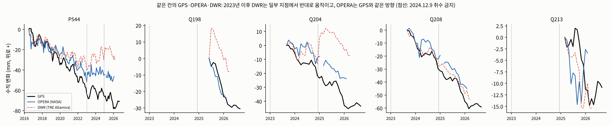
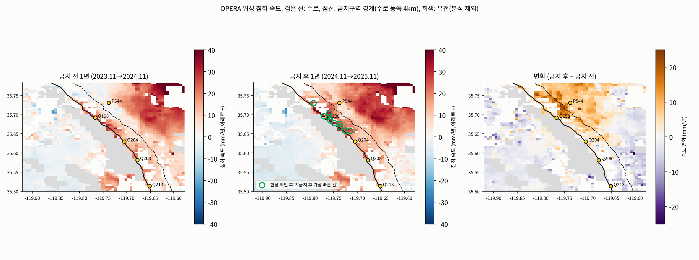
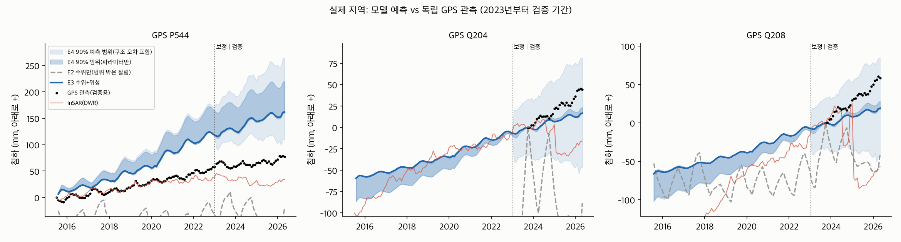
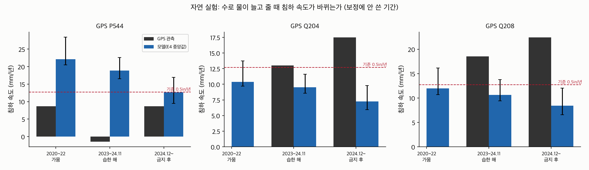
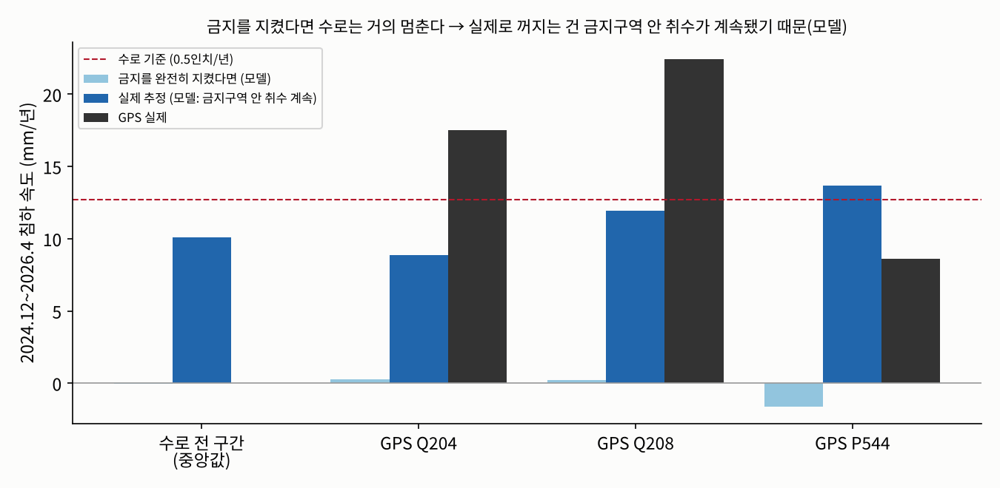
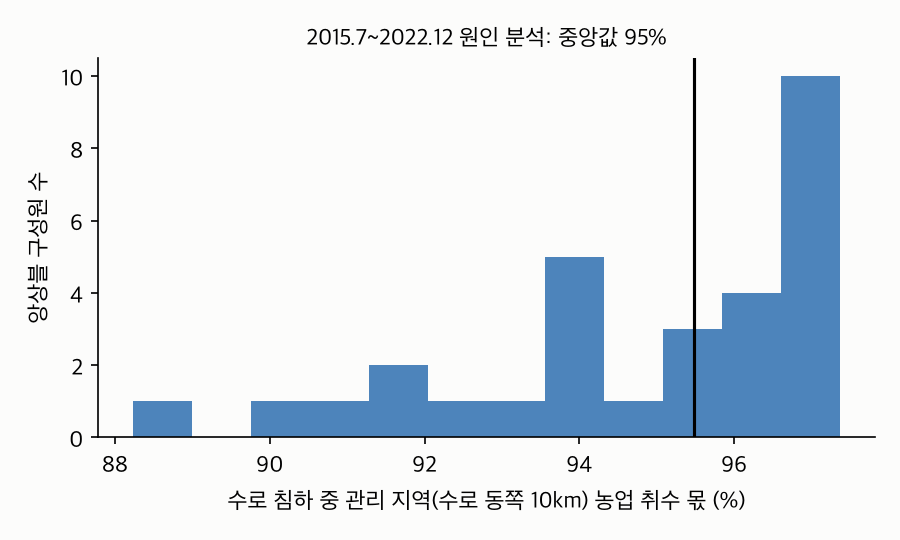
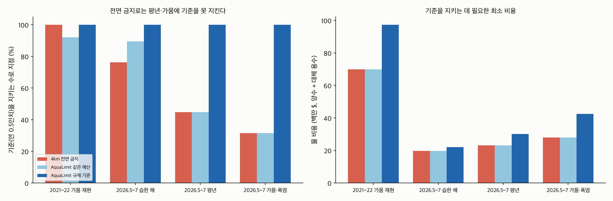
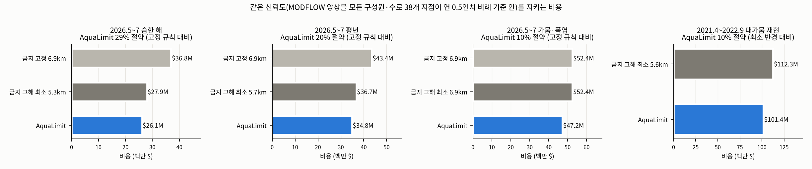
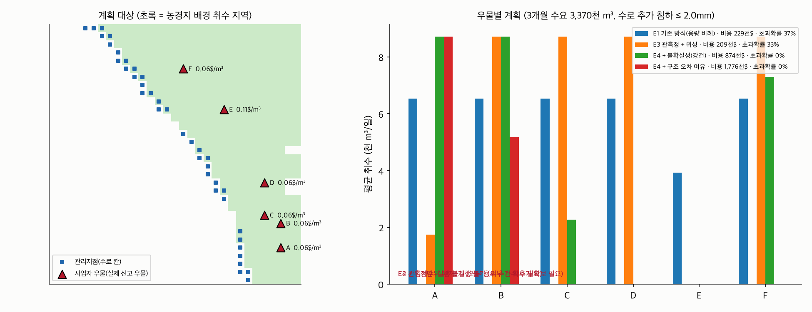
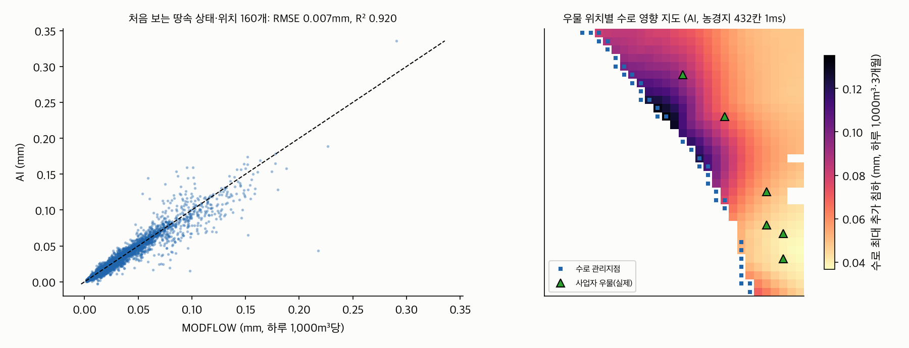

# AquaLimit (10/28)

## 1. 지난 발표(10/13) 이후 무엇을 바꿨나 (요약)

| 지난번 약점 | 이번에 한 일 | 결과 |
|---|---|---|
| 앞으로 3년 침하 예측이 단순 추세 연장보다 부정확 | 모델 v3: 지연 압밀(남·북 구역), 과거 취수 이력, 관개 회귀수. 구조 후보 6개(v4)를 더 시험 | GPS 오차 25.2 → **21.2mm**. 후보 6개 모두 v3보다 나빠 **v3 확정**. 3년 누적량은 아직 추세 연장(7.2mm)이 더 정확 |
| (10/23 발견) 연습 시험의 정답 위성 자료가 틀렸다 | 연습 기간(2020~22) GPS P544로 교차 확인 → 정답을 NASA OPERA로 바꿔 같은 모델을 다시 채점 | DWR가 침하를 절반만 잡음(GPS 27.8 / OPERA 24.9 / DWR 13.6mm). 모델의 '미래 과대예측' +18mm는 **자료 탓**이었고 OPERA 기준 편향은 **+2mm** |
| 불확실성 범위가 너무 넓음(265mm), 계산 방식도 과대 | 값 범위 현실화 + 90% 범위 계산 방식 수정 | GPS 포함률 **99%**, 폭 265 → **97mm** |
| "취수를 줄이면 덜 꺼지나"를 검증한 적 없음 | 자연 실험: 2023 습한 해, 2024.12 취수 금지(1년 단위로 채점) | 습한 해 감속은 **크기까지 맞힘**(GPS −9.3, 모델 −9.0mm/년), 금지 후 '줄지 않음'은 못 맞힘(모델은 감속 예측) → **보이지 않는 취수** 가능성 |
| 날씨·온도를 고려하지 않음(교수님 피드백) | 기온·수로 배분율을 모델과 날씨 시나리오에 직접 넣고, 빼 보는 실험으로 효과 확인 | 기상 빼면 21.2 → 23.5mm, 배분율 빼면 24.7mm로 **나빠짐** |
| 가정 우물 6개가 취수 금지구역 안 | DWR 우물 신고 자료의 **실제 우물**로 교체 | 금지구역 밖 실제 우물 6개, 정책 비교는 실제 우물 56개 |
| 2mm 기준이 근거 없는 가정값 | **실제 규제값** 연 0.5인치(12.7mm) | 이웃 관리기관의 같은 수로 최소기준 |
| AI가 비싸고 우물이 바뀌면 재학습 | **우물 위치를 입력으로 받는 AI** | 오차 R² 0.92, 땅속 상태 1,000개 계산 MODFLOW 11시간 → 1초 미만 |
| 사업 근거가 '가정 사업자 1곳' | **전면 금지 vs AquaLimit** 정책 비교(실제 우물 56개, 날씨별) | 전면 금지로는 평년 45%·가뭄 32% 지점만 기준 충족 |
| 같은 기준이면 금지를 넓히면 되지 않나? | **금지 반경 넓히기 vs AquaLimit**를 MODFLOW로 같은 신뢰도에 맞춰 비교 | 가뭄에도 지키는 고정 반경(6.9km) 대비 **평년 20%·습한 해 29%·가뭄 10% 절약**. 반경을 그해에 맞춰 가장 유리하게 골라도 5~10% |
| (10/23 발견) 선형 응답으로 푼 계획을 MODFLOW로 돌리면 기준 확률이 60%까지 떨어짐 | 계획을 **MODFLOW로 확인하고 어긋난 만큼 고쳐 다시 풀기**(3~4회) | 모든 구성원·모든 수로 지점 **100%**, 비용은 8~15% 더 듦 |
| 2023년 이후 DWR 위성 자료가 GPS와 반대 | **NASA OPERA 위성 자료**(상승·하강 궤도)로 교체, GPS로 교차 검증 | 방향 일치 DWR 3/5 → **OPERA 5/5**, 오차 17.0 → **8.3mm** |
| '보이지 않는 취수'가 모델 결과뿐 | **위성 관측만으로** 금지구역 안·밖 비교(이중차분) | 금지 후 금지구역 안이 밖보다 **+2.9mm/년 덜 좋아짐**(90% +0.6~+4.5) |

> "지난번에 받은 지적을 하나씩 실제 자료로 바꿨습니다. 가정값이던 우물과 기준을 실제 신고 우물과 실제 규제값으로 바꿨고, 온도와 수로 배분율을 모델에 넣은 뒤 빼 보는 실험으로 효과를 확인했습니다. 위성 자료도 GPS와 맞는 NASA 자료로 바꿨습니다."

---

## 2. 새로 확인한 사실: 금지했는데 줄지 않았다

### 실제 정책

| | 내용 |
|---|---|
| 누가 | Westside District Water Authority(지하수 관리기관) |
| 언제 | 2024.11.5 의결, **2024.12.9 시행**, 2025.5·2025.11·**2026.5.14 재연장**(6개월마다 연장 여부 결정) |
| 어디 | 수로 MP 195~215, **양쪽 2.5마일(4km)** 안 지하수 취수 전면 금지 |
| 위반 시 | $1,000 + 취수량 1AF당 $500 |

### GPS로 본 침하 속도 (mm/년, 아래로 +, 같은 달 → 같은 달 1년 단위)

| GPS | 2020.11→2022.11 (가뭄) | 2023.11→2024.11 (금지 전 1년, 배분율 40%) | **2024.11→2025.11 (금지 후 1년, 배분율 50%)** | 최근 1년 2025.3→2026.3 |
|---|---|---|---|---|
| P544 (북쪽) | 9.0 | 5.2 | **6.8** | 8.8 |
| Q204 (남쪽) | - | 15.4 | **15.9** | 18.8 |
| Q208 (남쪽) | - | 20.9 | **21.9** | 23.2 |
| Q213 (남쪽) | - | - | - | 12.2 |
| Q198 | - | - | - | (관측 1년 미만) |

- 금지 후 1년은 수로 물 배분율이 금지 전 1년보다 **높았는데도**(40% → 50%) 침하 속도가 **줄지 않았다**. 남쪽 3곳은 최근 1년 기준(연 12.7mm)을 넘는다.
- **주의(10/22 수정):** 처음 원고의 "금지 후 오히려 빨라졌다(Q204 13.0→17.5)"는 1년 단위가 아닌 구간(2024.12~2026.4는 겨울이 두 번)으로 잰 값이었다. 수로 GPS는 **여름에 수 mm 올라가고 겨울에 내려가는 계절 변동**이 있어서, 같은 달끼리 1년 단위로 비교해야 공정하다. 정확한 표현은 **"금지 후에도 줄지 않았다"**다.
- 북쪽(P544)은 2023년 습한 해에 바로 반등했지만, 남쪽은 계속 꺼졌다 → 남쪽 점토가 **늦게 눌린다**는 신호.
- 관리기관도, 주정부 검토(2025.9)도 "침하를 원인별로 나누지 못한다"고 했다. **AquaLimit이 답할 질문이 바로 이것이다.**

### 위성으로 다시 확인: NASA OPERA (10/22 추가)

DWR가 공급하는 위성 자료(TRE Altamira)는 2023년 이후 일부 지점에서 GPS와 반대(지반 상승)로 나와 그동안 2022년까지만 썼다. NASA JPL이 같은 Sentinel-1을 따로 처리한 **OPERA**(30m, 상승 1·하강 2개 궤도)를 받아 수직 성분을 풀고 GPS와 비교했다.



| 2023.1~2026.2 | 침하 방향이 GPS와 같은 지점 | 누적 곡선 오차 중앙값 |
|---|---|---|
| DWR (TRE Altamira) | 3/5 (P544·Q204에서 반대) | 17.0mm |
| **NASA OPERA** | **5/5** | **8.3mm** |

**위성만으로 본 금지 효과(모델 없음, 이중차분):** 금지 전 1년과 후 1년의 침하 속도 변화를 금지구역 안(수로 동쪽 4km 안 농경지)과 밖(4~10km)에서 비교했다. 금지가 지켜졌다면 안이 밖보다 더 좋아졌어야 한다.

| | 금지 후 − 금지 전 (mm/년) |
|---|---|
| 금지구역 안 | +5.1 |
| 금지구역 밖 | +2.3 |
| **안 − 밖 (금지 효과)** | **+2.9** (90% 범위 +0.6~+4.5) |



- 위성으로는 금지 효과가 보이지 않는다. 오히려 금지구역 안이 덜 좋아졌다. 모델이 따로 추정한 '금지구역 안 취수 1.36배'(5절)와 **같은 방향의 독립 근거**다.
- 금지구역 안에서 금지 후 가장 빨리 꺼지는 1km 칸 10곳(지도의 초록 원, 연 25~33mm)을 **현장 확인 후보 목록**으로 낸다. 단, 늦게 눌리는 점토 몫도 섞여 있어 '위반 확정'이 아니라 '먼저 확인할 곳'이다.
- 자세한 표: [real/results_opera/RESULTS.md](../../../real/results_opera/RESULTS.md)

> "NASA 위성으로 다시 보니, 금지가 시작된 뒤 금지구역 안의 침하가 밖보다 오히려 덜 좋아졌습니다. 계량 기록이 없어도 위성으로 규칙이 지켜지는지 점검할 수 있습니다."

### 실제 규제 기준

이 관리기관에는 수로 침하 수치 기준이 없다. 바로 남쪽 이웃 관리기관(Wheeler Ridge-Maricopa)이 **같은 수로에 정한 최소기준 연 0.5인치(12.7mm)**를 쓴다. 지금 남쪽 GPS 속도(13.7~22.4mm/년)는 이 기준을 넘는다.

> "관리기관은 2024년 12월부터 수로 주변 취수를 전면 금지했습니다. 그런데 GPS를 보면 금지 뒤에도 수로는 더 빨리 꺼지고 있습니다. 원인을 모르면 다음 조치도 정할 수 없습니다."

---

## 3. 모델 v3: 무엇을 바꿨나

| | 10/13 새 버전 | **v3** | 왜 |
|---|---|---|---|
| 점토가 눌리는 방식 | 수위가 내려가면 바로 눌림 | **지연 압밀**: 수위가 내려간 뒤에도 몇 년에 걸쳐 눌림 | 금지 후에도 계속 꺼지는 현상 |
| 지연 속도 | - | **남·북 구역을 따로** 추정 | GPS: 북쪽은 바로 반등, 남쪽은 계속 침하 |
| 시작 상태 | 2015년을 평형(아무 일 없던 상태)으로 시작 | **2005~2015 과거 취수 이력**을 먼저 계산(spin-up) | 2015년엔 이미 침하가 진행 중이었다 |
| 함양 | 비만 스며듦 | + **관개 회귀수**(밭에 뿌린 물이 다시 스며듦) | 빠진 물 수지 |
| 값 범위 | 점토 투수계수 6.3m/일, 함양 70% 같은 비현실적 값이 나옴 | 현실적 범위로 제한 | 모델이 다른 부족한 점을 엉뚱한 값으로 메우지 못하게 |
| 90% 범위 계산 | 앙상블 범위 끝에 오차를 또 더함(과대) | 앙상블 + 오차의 **예측 분포**에서 계산 | 포함률이 부풀려지지 않게 |

### 결과 (보정: 2015.7~2022.12 위성·관측정 → 채점: 보정에 안 쓴 2023~2026 GPS)



| 예측 방법 | GPS 침하 오차 |
|---|---|
| E2 관측정만 | 70.9mm |
| 10/13 새 버전 E3 | 25.2mm |
| **v3 E3 관측정 + 위성** | **21.2mm** |
| v3 E4 + 불확실성 | 22.6mm |
| (비교) 앞으로 안 꺼진다 | 22.1mm |
| (비교) 2015~2022 위성 추세 그대로 연장 | 7.2mm |

| E4 90% 예측 범위 | 10/13 | **v3** |
|---|---|---|
| 실제 GPS 포함률 | 100% | **99%** |
| 평균 범위 폭 | 265mm | **97mm** |
| 2019년까지로 보정해 2020~22를 예측한 오차(구조 오차) | √(38.6² + (28.9×연수)²) | **√(17.2² + (10.6×연수)²)** |

| 추정한 땅속 성질 | 값 | 뜻 |
|---|---|---|
| 지연 압밀 점토 투수계수 (북쪽) | 1.5×10⁻⁶ m/일 | |
| 지연 압밀 점토 투수계수 (남쪽) | **3.7×10⁻⁷ m/일** | 남쪽이 약 **4배 느리게** 눌린다 → GPS에서 본 남북 차이와 같은 방향 |
| 위성 침하 보정 오차 | 28.2mm | 10/13 30.8mm보다 개선 |

**위성 없이는 땅속을 정할 수 없다:** 관측정만 쓴 E2는 점토 성질을 정하지 못해 비현실적인 값으로 갔고, 그 근처에서는 MODFLOW가 수렴하지 못했다(실행 시간 초과). GPS 오차도 70.9mm로 위성을 넣은 E3(21.2mm)의 3배다.

**솔직한 한계:** 3년 전체 침하량은 여전히 단순 추세 연장(7.2mm)이 더 잘 맞힌다. 2022년까지 자료만으로는 금지 후 남쪽 침하 속도를 절반 이하로 봤다(모델 연 7~8mm, GPS 1년 단위 연 15.9~21.9mm). 위성 증발산으로 추정한 2025년 취수는 2024년보다 적은데 침하는 빨라졌다. 즉 **위성으로 보이지 않는 취수가 있었을 가능성**이 있다(5절).

### 연습 시험 다시 채점: 정답 위성 자료가 틀렸다 (10/23)

모델 구조는 **연습 시험**(2019년까지 보정 → 2020~22 위성 예측, 수로 2km 칸)으로만 고르고, 최종 시험(2023~26 GPS)은 확정할 때 한 번만 본다. 그런데 연습 시험 정답으로 쓴 DWR 위성 자료가 2020~22에 이미 틀리고 있었다.

| 2019.12 → 2022.12 침하 (mm) | GPS | NASA OPERA | DWR |
|---|---|---|---|
| P544 (연습 기간에 GPS가 있는 유일한 곳, 반경 0.75km 위성 칸 평균) | **27.8** | 24.9 | 13.6 |
| 수로 2km 안 500m 칸 중앙값 침하 속도 (mm/년, 2017~19 → 2020~22) | - | 12.0 → **17.1** (빨라짐) | 14.0 → 7.2 (느려짐) |

2021~22는 수로 배분율 5%의 대가뭄이라 침하가 빨라지는 것이 자연스럽다. DWR가 2023년 이후 GPS와 반대로 가는 문제(2절)가 2020년 무렵부터 시작된 것으로 보인다. 그래서 정답을 GPS로 확인된 OPERA로 바꾸고, **이미 보정해 둔 모델(재보정 없음)을 다시 채점만** 했다(`rescore_practice.py`, 결과 `real/RESCORE_PRACTICE.md`). 판정 규칙은 결과를 보기 전에 정했다.

| 수로 2km 칸 RMSE (mm) | DWR 정답 (기존) | **OPERA 정답** | GPS P544 |
|---|---|---|---|
| **v3 물리모델** | 25.1 | **14.0** | 21.0 |
| v4 후보 6개 중 가장 좋은 것(v4-emult) | 28.6 | 15.0 | 27.0 |
| v4-aq (수로 띠 압축 계수, 10/23 추가) | 43.3 | 24.9 | 28.2 |
| 결합 예측(추세 + 물리모델이 예측한 변화), v3 | 34.4 | 15.2 | 11.0 |
| 칸별 보정(1km 칸마다 '위성 ÷ 모델' 배수를 곱함), v3 (10/27) | 37.1 | 18.2 | 5.2 |
| 추세 연장 (2015~2019 위성 추세) | 27.2 | **10.4** | **4.1** |
| 변화 0 (앞으로 안 꺼진다) | 17.0 | 29.3 | 12.5 |

- **v3가 세 정답 모두에서 물리모델 1등** → 구조 실험을 끝내고 v3로 확정했다. 정답을 바꿔도 순위가 같아 고른 결과가 자료 오류에 기대지 않는다.
- 그동안 보인 '모델이 미래 침하를 과대예측'(편향 +17.9mm)은 DWR 자료 탓이었다. OPERA 기준 편향은 **+2.0mm**다.
- '변화 0'이 1등이던 기존 결과도 DWR 오류 때문이었다(OPERA 기준 29.3mm로 꼴찌).
- 불확실성 범위의 구조 오차도 OPERA 정답으로 다시 쟀다(`rescore_uncertainty.py`): √(7.4² + (6.9×연수)²)mm로 작아져 범위 폭이 97 → 59mm로 좁아지지만, GPS 포함률이 82%로 명목 90%에 못 미친다. 그래서 **기존 범위(포함률 99%, 폭 97mm)를 유지**한다. 2023년 이후 GPS 지점의 오차가 2020~22 수로 칸 오차보다 크다는 뜻이다.
- 칸별 보정(10/27)은 P544의 과대예측을 바로잡았지만(21.0 → 5.2mm) 수로 2km 칸에서는 칸마다 배수가 흔들려 오히려 나빠졌다(14.0 → 18.2mm). 규칙대로 탈락, 최종 시험은 돌리지 않았다. 칸마다 다른 점토 성질을 예측 뒤에 곱하지 말고 **모델 안에서 위성·GPS로 함께 보정**하는 것이 다음 단계다(12절).
- 3년 누적량은 여전히 **추세 연장이 가장 정확**하다(OPERA 10.4 vs v3 14.0mm, 최종 시험 GPS 7.2 vs 21.2mm). 규칙대로 최종 시험은 다시 돌리지 않았다. 이 지역 침하는 몇 년째 꾸준해서 추세가 강하다. 그래서 서비스는 **'지금처럼 하면' 전망은 위성 추세로, '취수를 바꾸면 얼마나 달라지나'(계획·정책)는 물리모델로** 낸다. 물리모델의 응답은 자연 실험으로 따로 확인했다(5절).

> "점토가 늦게 눌리는 현상과 과거 가뭄의 영향을 넣어 예측을 개선했습니다. 불확실성 범위는 실제 GPS를 99% 포함하면서 폭이 3분의 1로 줄었습니다. 남쪽 점토가 북쪽보다 4배 느리게 눌린다는 결과는 GPS에서 본 남북 차이와 같은 방향입니다."

### 무엇 덕분에 좋아졌나: 하나씩 빼고 다시 보정 (입력별 기여)

| 모델 | GPS 침하 오차 | 뜻 |
|---|---|---|
| v3 전체 | 21.2mm | |
| **기상(기온·습도·바람·일사) 해마다 같게** | 23.5mm (+2.3) | **온도가 예측을 좋게 한다** |
| **수로 물 배분율 해마다 같게** | 24.7mm (+3.5) | **가뭄 해 수로 물 부족이 핵심** |
| Landsat 밭별 정보 빼기(지역 평균 하나) | 19.2mm (−2.0) | 이 지역 수로 GPS 5곳 예측에는 밭별 차이가 도움이 안 됐다 |

> "교수님이 지적하신 날씨·온도를 넣었고, 빼 보면 예측이 나빠지는 것으로 효과를 확인했습니다. 반대로 밭별 위성 정보는 이 지역에서 도움이 안 됐고, 그 결과도 그대로 보고합니다."

---

## 4. 검증 모델과 운영 모델을 나눴다

실제 예보 시스템처럼 **채점용과 실제 운영용을 분리**했다.

| | 검증 모델 (v3) | 운영 모델 (v3ops) |
|---|---|---|
| 보정 자료 | 2015.7~2022.12 위성 + 관측정 | + **2023~2026.4 GPS·관측정까지 전부** |
| 용도 | 예측 성능 채점(보정에 안 쓴 GPS) | 계획·정책 비교·AI·데모 |
| 추가로 추정하는 값 | - | **금지 이후 금지구역 안·밖 취수가 위성 추정의 몇 배였나** |

- 성능 숫자(3절)는 검증 모델로만 말한다. 운영 모델의 GPS 오차(16.5mm)는 보정에 썼기 때문에 성능이 아니라 적합도다.
- 서비스로는 **새 위성·GPS 자료가 들어올 때마다 운영 모델을 갱신**한다(월 단위).

---

## 5. 응답 검증과 '보이지 않는 취수'

계획과 정책 비교는 **"취수를 바꾸면 침하가 얼마나 바뀌나(응답)"**로 결정된다. 실제로 취수가 크게 바뀐 사건을 **자연 실험**으로 썼다.



### 검증 모델(2022년까지 보정, 독립 검증)

| 사건 | GPS 속도 변화 | 모델 예측 변화 (90% 범위) | 방향 |
|---|---|---|---|
| 2023 습한 해 (배분율 5% → 100%), P544 | −10.1 mm/년 | −3.5 (−7.7~−1.2) | **맞음** (크기는 1/3) |
| 금지 후 (2024.12~), P544 | +10.1 | −6.9 | 틀림 |
| 금지 후, Q204 | +4.5 | −2.4 | 틀림 |
| 금지 후, Q208 | +3.9 | −2.4 | 틀림 |

- 수로 물이 늘어 지하수를 덜 뽑았을 때 침하가 느려지는 것은 맞혔다(이 표에선 크기를 작게 봤지만, 1년 단위로 재면 크기까지 맞는다 — 아래).
- **금지 후에는 모델이 감속을 예측했지만 실제로는 줄지 않았다.** 위성으로 추정한 취수만으로는 설명되지 않는다.
- (10/23) 위 표의 GPS 속도 변화는 1년 단위가 아닌 구간이라 계절 변동이 섞였다. **같은 달 → 같은 달 1년 단위로 다시 채점**했다(`validate_annual.py`, 모델도 같은 방식).

| GPS | 사건 | GPS 변화 | 검증 모델 v3 (독립, 90% 범위) | 일치 |
|---|---|---|---|---|
| P544 | 습한 해 (2021.11→22.11 vs 2022.11→23.11, 배분율 5% → 100%) | −9.3 | **−9.0** (−11.8~−6.1) | **예, 크기까지** |
| P544 | 금지 (2023.11→24.11 vs 2024.11→25.11, 배분율 40% → 50%) | +1.5 | −11.9 (−15.0~−8.5) | 아니오 |
| Q204 | 금지 | +0.6 | −4.0 (−4.8~−2.6) | 아니오 |
| Q208 | 금지 | +1.0 | −4.0 (−5.1~−2.6) | 아니오 |

- 1년 단위로 재면 **습한 해 감속은 크기까지 맞는다**(전에는 '크기 1/3'로 보였던 것도 계절 변동 탓이었다).
- 금지 후에는 검증 모델이 감속을 예측했지만(수로 물 증가 + 과거 침하 감쇠) 실제로는 줄지 않았다. 운영 모델(금지 후 취수 배수 추정 포함)은 같은 1년 단위로 4/4 맞는다(적합도). 결과: `results_validate_v3/RESULTS_annual.md`, `results_validate_v3ops/RESULTS_annual.md`

### 운영 모델: 보이지 않는 취수를 거꾸로 추정

관정별 계량 기록은 비공개다. 운영 모델은 2024.12 이후 취수가 위성 증발산 추정의 몇 배였는지를 GPS 침하로 역산했다.

| 구역 | 위성 추정 대비 실제 취수 (90% 범위) |
|---|---|
| **금지구역 안**(수로 양쪽 2.5마일) | **1.36배** (0.99~1.87) |
| 금지구역 밖 | 0.90배 (0.62~1.31) |

이 값을 넣으면 금지 후 속도 변화 4개 모두 방향이 맞는다(운영 모델, GPS를 보정에 썼으므로 적합도).

**(10/22) 위성 자료를 NASA OPERA로 바꿔 다시 추정:** OPERA는 2026.2까지 GPS와 맞으므로, 운영 모델이 2023년 이후 위성 면 자료(약 3만 3천 개 관측)까지 보정에 쓰게 했다(`results_v3ops-opera/`).

| 보정 자료 | 금지구역 안 (90% 범위) | 금지구역 밖 (90% 범위) |
|---|---|---|
| DWR(~2022) + GPS 5곳 (기존) | **1.36배** (0.99~1.87) | 0.90배 (0.62~1.31) |
| NASA OPERA(~2026.2) + GPS 5곳 | 1.08배 (0.88~1.33) | **1.23배** (1.08~1.39) |

- 두 경우 모두 금지 후 어딘가에서 위성 증발산 추정보다 더 뽑았다. **어디서**(금지구역 안 vs 밖)는 자료에 따라 갈린다. GPS 5곳만 보면 금지구역 안, 위성 면 자료를 넣으면 금지구역 밖(특히 북동쪽 큰 침하 지역)으로 간다.
- OPERA 운영 모델은 위성 적합 오차가 45.5mm로 크다(3×3 구역 압축 계수로는 북동쪽 큰 침하 지역과 서쪽 칸별 차이를 다 담지 못함). 그래서 이 값도 '정답'이 아니라 **추정이 자료에 민감하다는 증거**로 쓴다.
- **원인 분해 결론은 두 모델이 같다.** OPERA 운영 모델로 다시 나눠도 금지 후 수로 침하 연 10.2mm = 과거 취수 −5.1 + 금지구역 밖 +6.8 + 금지구역 안에서 계속된 취수 +8.0, **금지를 완전히 지켰다면 연 1.8mm**(DWR 모델은 약 0). 자연 실험 방향 4/4(적합도). `results_validate_v3ops-opera/`
- **밭은 금지 후에도 계속 물을 썼다(Landsat NDVI, 모델 없음):** 금지구역 안 농경지 관개기 평균 녹색도 2024년 0.359 → 2025년 0.356 → 2026년 0.391. 휴경하지 않았다. 그 물이 지하수인지 수로 물·외부 구입 물인지는 위성으로 알 수 없다.
- 발표에서는 '금지구역 안에서 몰래 뽑았다'고 단정하지 않는다. 위성 이중차분(2절)과 모델 역산을 함께 써서 **먼저 확인할 곳**을 고르고, 확정은 유량계로 한다.

> "위성으로 본 작물 물 사용과 GPS 침하를 함께 보면, 금지 이후에도 금지구역 안에서 위성 추정보다 많은 물이 뽑혔을 가능성이 나옵니다. 계량 기록이 없어도 관리기관이 현장 확인할 구역을 고를 수 있습니다."

**주의:** 1.36배의 90% 범위 하한이 0.99배라 '확실하다'가 아니라 '가능성이 높다'로 말한다. 모델 구조 오차일 수도 있다.

---

## 6. 금지 뒤에도 꺼지는 이유 (원인 분해, 운영 모델)

2024.12~2026.4 수로 침하를 시나리오 세 개(금지 안 함 / 금지 / 모든 농업 취수 중단)를 같은 앙상블로 계산해 나눴다.



| 원인 | 수로 전 구간 (mm/년, 중앙값) |
|---|---|
| 실제 추정 침하(금지구역 안 취수 계속) | **10.1** |
| └ 과거 취수의 영향 | −5.0 (수위 회복으로 되올라오는 몫) |
| └ 금지구역 밖 취수 | +4.7 |
| └ **금지구역 안에서 계속된 취수** | **+9.9** |
| 금지를 완전히 지켰다면 | **약 0** |

- 모델로는 **금지를 완전히 지켰다면 수로 침하는 거의 멈췄다.** 실제로 꺼지는 가장 큰 몫은 금지구역 안에서 계속된 취수다.
- 관리기관이 할 일: **금지구역 안 미계량 취수 확인 + 기준을 지키는 데 필요한 금지구역 밖 관리(7절).**

### 2015~2022 원인 분석

수로 침하 중 **관리 지역(수로 동쪽 10km) 농업 취수 몫: 95%** (90% 범위 91~97%). 관리 지역 농업 취수를 0으로 두고 같은 기간을 다시 계산해 비교했다.



> "금지가 지켜졌다면 수로는 거의 멈췄을 겁니다. 그런데도 꺼진다는 건 금지구역 안 취수가 계속됐을 가능성이 높다는 뜻입니다."

---

## 7. 핵심 결과: 전면 금지 vs AquaLimit

**우물:** DWR 우물 신고 자료의 농업용 신규 우물 56개(금지구역 안 21개), 위치로 12개 묶음. **관리 지역:** 수로 동쪽 10km 농경지 330칸. **대체 용수:** $0.81/m³(≈$1,000/AF). **기준:** 연 0.5인치(3개월 3.2mm). 모든 정책은 MODFLOW 앙상블 30개로 다시 돌려 확인했다.



### 다음 관개기(2026.5~7), 날씨별 (기온·수로 배분율 반영)

| 시나리오 | 4km 전면 금지 | | AquaLimit 같은 예산 | AquaLimit 규제 기준 달성 (MODFLOW로 확인·보정) | |
|---|---|---|---|---|---|
| | 비용 | **기준 지키는 지점** | 기준 지키는 지점 | 비용 | 금지 대비 |
| 습한 해 (−1.5°C, 배분율 45%) | $19.8M | 76% | **89%** | $26.1M | +$6.3M |
| 평년 (배분율 30%) | $23.2M | **45%** | 45% | $34.8M | +$11.6M |
| 가뭄·폭염 (+2.5°C, 배분율 15%) | $27.9M | **32%** | 32% | $47.2M | +$19.3M |

규제 기준 계획은 선형 응답으로 처음 풀면 습한 해 $22.0M·평년 $30.2M·가뭄 $42.5M이지만, MODFLOW 앙상블로 돌리면 모든 지점이 기준 안일 확률이 80%·60%·60%뿐이다(취수를 늘려서 잰 응답을 줄이는 쪽에 써서 생기는 비선형). 그래서 계획을 MODFLOW로 확인하고, 구성원·지점마다 'MODFLOW 변화 ÷ 선형 변화' 비율로 응답을 고쳐 다시 푼다(3~4회, `refine_plan.py`). 위 표가 그 결과다: 모든 구성원·모든 지점 100%.

### 2021.4~2022.9 대가뭄 재현

| 정책 | 비용 | 기준 지키는 지점 | 모든 지점이 기준을 지킬 확률 |
|---|---|---|---|
| 현재 방식 | $14.0M | 39% | 0% |
| 4km 전면 금지 | $70.0M | 100% | 70% |
| AquaLimit 같은 최악 지점 보호 | $67.8M (−3%) | 100% | 73% |
| AquaLimit 규제 기준 (선형 응답으로 푼 계획) | $97.3M | 100% | 97% |
| AquaLimit 규제 기준 (MODFLOW로 확인·보정 3회) | $101.4M | 100% | **100%** |

참고: 2026년 실제 수로 배분율은 5.15에 45%로 올랐다. 이번 관개기는 배분율로는 '습한 해' 시나리오에 가깝다.

### 그럼 금지를 넓히면 되지 않나? (10/22 추가, 10/23 MODFLOW로 확인)

관리기관이 바로 떠올릴 대안은 '금지 반경을 넓히기'다. 금지 반경과 AquaLimit을 **같은 신뢰도**(MODFLOW 앙상블 모든 구성원에서 수로 38개 지점이 모두 연 0.5인치 비례 기준 안)에 맞춰 비용을 비교했다. 금지 반경은 MODFLOW로 직접 돌려 기준을 지키는 가장 작은 반경을 0.1km 단위로 찾았고, AquaLimit은 위의 MODFLOW 보정 계획이다.



| 상황 | 금지: 가뭄에도 지키는 고정 반경 6.9km | 금지: 그해에 맞는 최소 반경 | **AquaLimit** | 절약 (고정 규칙 대비) | 절약 (최소 반경 대비) |
|---|---|---|---|---|---|
| 2026.5~7 습한 해 | $36.8M | 5.3km $27.9M | **$26.1M** | **$10.8M (29%)** | $1.8M (7%) |
| 2026.5~7 평년 | $43.4M | 5.7km $36.7M | **$34.8M** | **$8.6M (20%)** | $1.9M (5%) |
| 2026.5~7 가뭄·폭염 | $52.4M | 6.9km $52.4M | **$47.2M** | $5.3M (10%) | $5.3M (10%) |
| 2021.4~2022.9 대가뭄 재현 | - | 5.6km $112.3M | **$101.4M** | - | $10.9M (10%) |

- 반경은 한 번 정하면 해마다 바꾸기 어렵다. 가뭄에도 지키려면 6.9km로 넓혀야 하고, 그러면 평년·습한 해에는 필요 이상으로 멈춘다. AquaLimit은 그해 날씨에 맞춰 우물별로 다시 계산한다.
- 반경을 그해 날씨를 미리 알고 0.1km 단위로 가장 유리하게 골라도(현실에서는 모델 없이 불가능) AquaLimit이 5~10% 싸다.
- 선형 응답으로만 계산했던 10/22 결과(고정 반경 6km, 평년 20%·습한 해 31%)와 절약 비율은 거의 같다. 다만 MODFLOW로 직접 돌리니 가뭄에 필요한 반경이 6km가 아니라 6.9km였다. 자세한 표: [RESULTS_refine.md](../../../real/results_policy_v3ops/RESULTS_refine.md)

### 읽는 법

1. **전면 금지로는 평년·가뭄에 기준을 못 지킨다.** 평년엔 수로 지점의 45%, 가뭄·폭염엔 32%만 기준을 지킨다. 가뭄일수록 금지구역 밖 취수가 늘기 때문이다.
2. **같은 보호 수준에서는 전면 금지도 효율적인 편이다**(AquaLimit 최적 배분과 3% 차이). 이 지역에서 수로에 가장 영향이 큰 우물이 수로 가까운 우물이라서다.
3. **AquaLimit의 가치는 '무엇을 더 해야 하는지'를 정하는 것이다.** 기준을 모든 지점에서 지키는 가장 싼 감량안을 계산한다. 금지 반경을 가뭄에 맞춰 넓히는 것보다(6.9km) 같은 신뢰도에서 평년 20%, 습한 해 29% 싸다. 선형 계산으로 푼 계획은 MODFLOW로 확인해 고친다.
4. **같은 예산이면** 배분을 바꿔 습한 해에 기준 지점을 76% → 89%로 늘린다.
5. **규칙이 지켜지는지 위성으로 점검한다**(2절 OPERA 이중차분, 5절 보이지 않는 취수).

> "전면 금지는 단순하고, 같은 보호 수준에서는 꽤 효율적입니다. 문제는 금지만으로는 평년에 절반, 가뭄에 3분의 2의 수로 지점이 기준을 넘는다는 겁니다. 그렇다고 반경을 가뭄에 맞춰 넓히면, 같은 신뢰도에서 AquaLimit보다 평년에 25% 더 듭니다. AquaLimit은 기준을 지키는 가장 싼 감량안과, 그 규칙이 실제로 지켜지는지를 함께 알려 줍니다."

---

## 8. 사업자 계획: 실제 신고 우물 6개 (금지구역 밖)

10/13에는 가정 우물 6개가 금지구역 안에 있었다. 이번에는 **금지구역 밖 실제 신고 우물 6개**(수로에서 4.2~6.0km)로 바꿨다. 3개월 수요 337만 m³(용량의 75%), 계획 추가 침하 한도 2mm/3개월(0.5인치 기준 중 이 사업자 몫, 가정).



| 방식 | 비용 | 기준 초과 확률 (계획에 안 쓴 땅속 상태 30개) | 실제 땅이 25% 더 반응하면 |
|---|---|---|---|
| E1 기존 방식(용량 비례) | $229천 | 47% | 73% |
| E2 관측정만 | 실행 불가 (땅속을 못 정해 응답이 비현실적) | - | - |
| E3 관측정 + 위성 | $209천 | 47% | 67% |
| E4 + 불확실성 | $874천 | **7%** | 20% |
| **E4 + 구조 오차 여유 100%** | $1,776천 | **0%** | **0%** |

- E4 계획을 새 땅속 상태 30개에 MODFLOW로 직접 넣어도 기준 초과 7%(최대 추가 침하 평균 1.35mm).
- 임계수위(과거 최저 수위) 유지는 이 사업자 혼자서는 불가능하다. 다른 농가 취수만으로 이미 아래다 → **지역 관리기관 단위 서비스가 필요하다.**

### 여유를 얼마나 둘지 = 비용

10/13 한계: "실제 땅이 25% 더 반응하면 E4도 87% 확률로 기준 초과". 이번에는 **구조 오차 여유**를 계획에 직접 넣었다.

| 여유 | 비용 | 초과 확률: 모델대로 | 실제 반응 1.25배 | 1.5배 |
|---|---|---|---|---|
| 0% | $874천 | 0% | 13% | 33% |
| 25% | $1,229천 | 0% | **0%** | 10% |
| 50% | $1,471천 | 0% | 0% | **0%** |
| 100% | $1,776천 | 0% | 0% | 0% |

> "여유를 25% 두면 비용이 41% 늘고, 실제 땅이 모델보다 25% 더 반응해도 기준을 지킵니다. 고객이 위험과 비용 사이에서 고르게 합니다."

### 날씨 시나리오 (교수님 피드백 반영)

기온이 오르면 작물 증발산이 늘고(Hargreaves 식), 수로 물 배분율이 줄면 지하수를 더 뽑는 연결을 그대로 계산한다.

| 시나리오 | 수로 배경 침하 (3개월, 중앙값) |
|---|---|
| 습한 해 (−1.5°C, 배분율 45%) | 7.0mm |
| 평년 (배분율 30%) | 8.6mm |
| 가뭄·폭염 (+2.5°C, 배분율 15%) | **12.9mm** |

---

## 9. 위치 입력 AI

**10/13 AI의 문제:** 우물 6개 위치가 고정이라 우물이 바뀌면 다시 학습해야 했고, 데모에서는 속도 차이가 보이지 않았다.

**바꾼 것:** 우물 **위치**를 입력으로 받는다. 지도에서 아무 농경지 칸이나 고르면 바로 계산된다.



**그림 읽는 법:** 왼쪽은 처음 보는 땅속 상태·위치 160개에서 AI와 MODFLOW를 비교한 것이다. 점이 대각선에 붙을수록 정확하다. 오른쪽은 각 칸에 우물을 놓았을 때 수로가 얼마나 더 꺼지는지 보여 준다. 진할수록 위험하며, 수로 가까운 중·북부가 가장 위험하다. 초록 삼각형(실제 사업자 우물)은 영향이 작은 곳에 있다.

| | |
|---|---|
| 입력 | 땅속 성질 23개 + 우물 위치(동서·남북 좌표, 수로까지 거리) |
| 출력 | 그 위치에서 하루 1,000m³를 3개월 뽑을 때 수로 38곳 추가 침하·수위 변화 |
| 학습 자료 | MODFLOW 1,000회(땅속 상태 200개 × 무작위 위치 4곳 + 기준) |
| 처음 보는 땅속 상태·위치 | 오차 0.007mm, R² 0.92 |
| 실제 우물 6곳에서 MODFLOW와 차이 | 0.018mm (응답 크기 0.21mm 대비 약 9%) |
| 농경지 432칸 전체 영향 지도 | AI **1ms** / MODFLOW 433회 ≈ 42분 |
| 땅속 상태 1,000개 × 우물 6곳 | AI **1초 미만** / MODFLOW 약 **11시간** |
| AI로 1,000개 강건 계획 → MODFLOW 30개로 확인 | 기준 초과 **0%** (AI 오차 여유 0.06mm 적용) |

> "어느 칸에 우물을 놓아도 땅속 상태 1,000개에서의 영향을 즉시 계산합니다. 물리모델로는 11시간 걸리는 계산입니다. AI로 고른 계획은 마지막에 물리모델로 다시 확인합니다."

---

## 10. 데모 (app_final.py)

| 탭 | 보여주는 것 |
|---|---|
| ① 문제 | 위성 침하 지도, 금지구역, GPS별 최근 1년 침하 속도, 금지 후 원인 분해(mm/년), **NASA 위성 금지 전후 지도·이중차분** |
| ② 관리기관 | 전면 금지 vs AquaLimit 표, 기준 지키는 지점·비용 카드, 상황(과거 가뭄/날씨 시나리오) 선택, **금지 반경 넓히기 vs AquaLimit 표(MODFLOW로 확인한 같은 신뢰도 비용)**, MODFLOW 보정 계획 줄 |
| ③ 사업자 | **지도에서 우물 고르기 → 위치 AI가 땅속 상태 1,000개로 계획**, 구조 오차 여유 선택 |
| ④ 믿을 만한가 | 보정에 안 쓴 GPS 채점표(단순 예측 포함), 자연 실험 |

실행: `cd real && streamlit run app_final.py`

3분 시연 대본과 예상 질문: [DEMO_SCRIPT.md](DEMO_SCRIPT.md)

---

## 11. 한계

- 3년 전체 침하량 예측은 아직 단순 추세 연장보다 부정확하다(GPS로 확인된 OPERA로 다시 채점해도 같음, 3절). 계획·정책은 응답(취수 변화의 효과)으로 정해지므로 응답은 자연 실험으로 따로 확인했고(1년 단위), 습한 해 감속은 크기까지 맞혔지만 금지 후에는 감속을 예측했는데 실제로는 줄지 않았다.
- 수로 GPS에는 여름에 올라가고 겨울에 내려가는 계절 변동(수 mm~10mm대)이 있다. 속도 비교는 같은 달끼리 1년 단위로 해야 하고, 3개월 GPS 변화로 연 기준 위반을 판정하면 안 된다. 운영 모델은 월별 GPS를 그대로 보정에 써서 이 변동이 1.36배 추정에 섞였을 수 있다(OPERA로 다시 보정 중).
- '보이지 않는 취수'의 위치는 자료에 따라 갈린다(DWR+GPS: 금지구역 안 1.36배 / OPERA+GPS: 안 1.08배·밖 1.23배). 가능성으로만 말하고 현장 확인 후보로 쓴다.
- 관정별 실제 취수(계량) 기록은 비공개다. 위성 증발산·기상·수로 배분율로 추정하고, 나머지는 보정하고, 금지 이후는 GPS로 역산한다.
- 우물 56개 중 신고 양수량이 있는 우물은 5개뿐이다. 나머지는 신고 중앙값이다.
- 코코란 점토는 지연 압밀로 계산하면 수렴하지 않아 비지연으로 두었다. 대수층 안 점토층만 지연 압밀이다.
- 관측정만 쓴 E2는 마지막으로 수렴한 반복 결과를 쓴다.
- 연 0.5인치 기준은 이웃 관리기관 값이다.
- OPERA는 500m 칸 평균이라 수로 바로 옆 GPS보다 속도를 조금 작게 본다(P544·Q204·Q213). 2026.3 이후 OPERA는 아직 받지 못했다.
- 금지 반경·AquaLimit 비교는 MODFLOW 앙상블로 확인했지만, 다음 관개기는 구성원 15개(과거 재현 30개)라 '100%'는 15개 모두라는 뜻이다. 구성원을 늘리면 꼬리 위험이 더 보일 수 있다.
- 한 지역(MP 195~215)만 했다. 다른 지역 자동 적용은 다음 단계다.

## 12. 다음 할 일

| 작업 | 내용 |
|---|---|
| 다른 지역 자동 적용 | 센트럴밸리 안 범위 입력 → 자료 수집 → 모델 생성 → 보정 자동화. 두 번째 지역(프라이언트-컨 운하 주변)으로 실증 |
| 고객 검증 | 관리기관(WDWA)·수로 운영(DWR CASP) 질문 메일 초안 완료([docs/outreach](../../outreach/README.md)), 발송 |
| 3년 누적 예측 보완 | 구조 후보 실험은 10/23 종료: 구역을 잘게(kv9)·수로 띠(aq)·지연 압밀 확장 등 6개 모두 연습 시험에서 v3보다 나빴고, OPERA로 보정한 검증 모델(v3-opera)도 GPS 21.8mm로 개선 없음. 예측 뒤에 칸별 배수를 곱하는 방식(10/27)도 수로 칸에서 나빠짐. 다음은 1km 칸별 점토 압축성을 모델 안에서 OPERA·GPS로 함께 보정(칸끼리 너무 달라지지 않게 묶는 정규화 + ES-MDA 앙상블)하고, 연습 시험 → 최종 시험 순서로 확인 |
| 계획 확인 앙상블 늘리기 | 금지 반경·AquaLimit 계획 확인을 구성원 15개 → 60개로(꼬리 위험). 10/23 MODFLOW 확인·보정(refine_plan.py)은 완료 |
| 국내 적용 | 농림위성(2026.7.7 발사) 밭별 물 사용, 수자원위성(2027)·아리랑 6호(2027 2분기 예상) 변위로 입력 교체. 시범: 도심 굴착공사·제주 취수 배분([docs/KOREA.md](../../KOREA.md)) |

---

## 부록: 실행

```bash
cd real
caffeinate -i bash run_all.sh 2>&1 | tee log_all.txt   # 12단계. 멈추면 다시 실행(끝난 단계 건너뜀)
streamlit run app_final.py
```

| 단계 | 스크립트 | 결과 폴더 | 걸린 시간(10코어 맥) |
|---|---|---|---|
| 1 검증 모델 | run_real.py | results_v3/ | 약 8분(E2 제외) |
| 2 자연 실험 | validate_response.py | results_validate_v3/ | 2분 |
| 3 운영 모델 | AQ_VARIANT=v3ops run_real.py | results_v3ops/ | 6분 |
| 4 금지 후 원인 | AQ_VARIANT=v3ops validate_response.py | results_validate_v3ops/ | 2분 |
| 5 정책 비교 | AQ_VARIANT=v3ops policy_real.py | results_policy_v3ops/ | 25분 |
| 6~8 사업자 계획·날씨·표본 밖 | run_plan.py, run_weather.py, eval_plan_oos.py | results_plan_v3ops/ | 30분 |
| 9 위치 AI | surrogate_loc.py | results_ai_v3ops/ | 25분 |
| 10~12 입력별 기여 | AQ_VARIANT=v3_no… run_real.py --e3-only | results_v3_no…/ | 각 4분 |
| (10/22) OPERA 정리 | prepare_opera.py --build, opera_analysis.py | data/opera_grid500m_monthly.npz, results_opera/ | 몇 초 |
| (10/22) 금지 반경 비교 | AQ_VARIANT=v3ops policy_ban_radius.py | results_policy_v3ops/RESULTS_radius.md | 몇 초 |
| (10/23) 연습 시험 다시 채점 | AQ_VARIANT=… rescore_practice.py (변형마다), --table | results_*/results_dev_rescore.json, RESCORE_PRACTICE.md | 변형마다 1분 안쪽 |
| (10/23) 구조 오차 다시 재기 | AQ_VARIANT=v3 rescore_uncertainty.py | results_v3/RESULTS_uncertainty.md | 1분 |
| (10/23) 금지 반경·계획 MODFLOW 확인·보정 | AQ_VARIANT=v3ops refine_plan.py (--aq-only) | results_policy_v3ops/RESULTS_refine.md, policy-4-refine.png | 16분 + 7분 |
| (10/22) OPERA 운영 모델 | AQ_INSAR=opera AQ_VARIANT=v3ops run_real.py, validate_response.py | results_v3ops-opera/, results_validate_v3ops-opera/ | 2코어 약 1시간 |

### 출처

- 취수 금지(WDWA GSA): https://wdwagsa.specialdistrict.org/groundwater-extraction-moratorium-in-close-proximity-to-critical-infrastructure
- 금지 보도(SJV Water, 2025.1): https://sjvwater.org/kern-groundwater-agency-bans-pumping-along-sinking-california-aqueduct/
- 이웃 관리기관 수로 침하 기준(0.5인치/년), Kern 하위유역 검토: https://www.waterboards.ca.gov/water_issues/programs/gmp/docs/kern/202501-kern-final-staff-report-appendix-d.pdf
- 주정부 검토 요약(2025.9): https://www.waterboards.ca.gov/water_issues/programs/sgma/docs/kern/202509-kern-exec-summary-en.pdf
- GPS: Nevada Geodetic Laboratory, https://geodesy.unr.edu
- NASA OPERA DISP-S1(JPL/ASF): https://www.jpl.nasa.gov/go/opera
- 금지 재연장(2026.5.14) 이사회 안건: https://wdwagsa.specialdistrict.org/files/001d88377/20260514_WDWA+Board+Meeting+Agenda+FINAL.pdf
