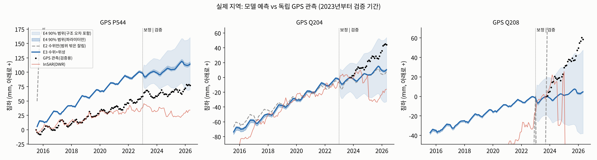
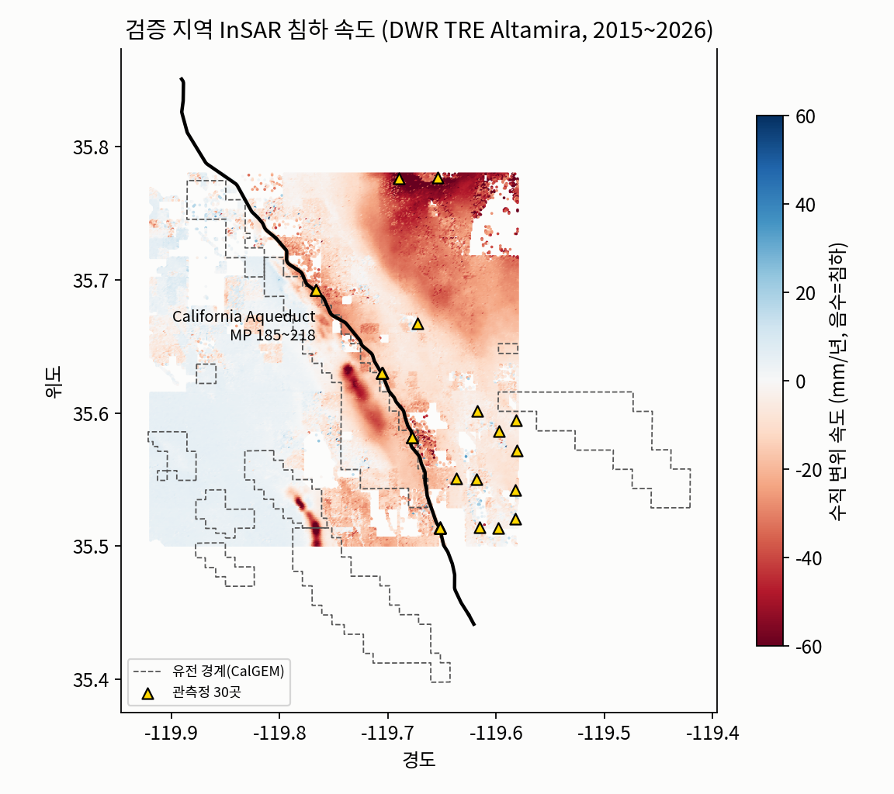

# 실제 검증 지역 (California Aqueduct MP 195~215)

Lost Hills 주변 31km × 31km. 위성(InSAR)·관측정·USGS CVHM2로 지하수·침하 물리모델을 만들고, 보정에 쓰지 않은 **GPS로 예측을 검증**한 뒤, 침하 기준을 지키는 취수 계획과 AI 대리모델까지 만든 폴더다.

| 단계 | 결과 문서 | 한 줄 요약 |
|---|---|---|
| 1. 자료 확보 | 이 문서 1절 | InSAR 측정점 74,944개, 관측정 30곳, GPS 5곳, 강수, 유전 경계, CVHM2 층 구조 |
| 2. 역산 + GPS 검증 | [results/RESULTS.md](results/RESULTS.md) | GPS 침하 예측 오차 **467mm(E2) → 20.5mm(E3)**, E4 90% 범위가 GPS 94% 포함 |
| 3. 취수 계획 | [results_plan/RESULTS.md](results_plan/RESULTS.md) | 기준 초과 확률 E1 100% · E3 63% · **E4 0%** (비용 117 / 98 / 153천$) |
| 3+. 날씨 시나리오 | [results_plan/RESULTS_weather.md](results_plan/RESULTS_weather.md) | 배경 침하 습한 해 2.0 / 평년 2.7 / 가뭄 해 3.9mm(3개월). 평년 계획은 가뭄 해에 초과 확률 43%, 세 시나리오 모두 고려하면 0%(비용 +38%) |
| 4. AI 대리모델 | [results_ai/RESULTS.md](results_ai/RESULTS.md) | MODFLOW 대비 오차 0.14mm(R² 0.997), 앙상블 1,000개 계산 0.1초(MODFLOW면 약 15시간) |
| 비교: 가정 층 구조 | [results_simple/RESULTS.md](results_simple/RESULTS.md) | CVHM2 대신 단순 3개 층을 가정했을 때(10/12 첫 버전) |



## 1. 자료



| 자료 | 내용 | 파일 |
|---|---|---|
| InSAR 수직 변위 | DWR TRE Altamira(Sentinel-1) 측정점 74,944개, 2015.1~2026.4, 약 6일 간격, mm | `data/insar_points_velocity.csv`, `data/insar_grid500m_monthly.npz` |
| 지하수위 | DWR 정기 측정 관측정 30곳, 1,831건 | `data/wells.csv`, `data/gwl_measurements.csv` |
| GPS 수직 위치 | 수로 GPS 5곳(Nevada Geodetic Lab, IGS20) — **검증 전용** | `data/gps_monthly.csv` |
| 강수 | NOAA Lost Hills·Buttonwillow 관측소 월 강수(함양) | `data/precip_monthly.csv` |
| 층 구조·지질 | USGS CVHM2 13개 층 → 4개 묶음(상부 대수층 / 코코란 점토 / 하부 대수층 위·아래), 조립질 비율, 압축 점토 두께 | `data/cvhm2_box.npz` (`fetch_cvhm2.py`로 생성) |
| 수로·측량점·유전 | SWP 반복구간 선형, 정밀측량점, CalGEM 유전 경계 | `data/*.geojson` |

### 자료에서 발견한 것

- **유전 침하가 섞여 있다.** 수로 2km 이내 격자 39%가 Lost Hills·Belridge 유전 안이다. 석유 생산 침하를 지하수 침하로 오인하지 않도록 유전 격자는 역산·취수에서 뺐다.
- **2023년 이후 InSAR와 GPS가 어긋난다.** 2015~2022년에는 잘 맞지만(P544 2022.6: GPS 47mm, InSAR 38mm 침하) 2023년 이후 InSAR는 지반이 올라가고 GPS는 계속 침하한다(P544 2025.12: GPS 72mm, InSAR 33mm). 2023년 이후 InSAR는 쓰지 않고 GPS로 검증했다. 공개 위성 자료도 GPS로 교차 검증하는 **자료 품질 검사**가 서비스에 필요하다.
- **수로 옆 관측정은 최근에 생겼다.** 다층 관측정 4곳은 2023~2025년 설치, 장기 관측정(2014~)은 수로에서 4.6~8.6km.

## 2. 모델

- MODFLOW 6 + CSUB, 1km 격자 32×31, 4개 층 묶음(CVHM2), 2015.7~2026.4 월 단위
- 압축층: 과거 최저 수위(선행압밀수위) 아래로 내려가면 비탄성(영구) 압축. 계수는 CVHM2 값(비탄성 4.4e-4/m, 탄성 2.5e-5/m) × 구역별 보정 배수(역산)
- 함양 = 강수 × 비율(역산), 농경지(수로 동쪽) 취수 = 기본량 × 관개기(4~9월) × 가뭄 계수(역산) — 관정별 기록이 공개되지 않아 크기를 역산
- 역산: 가우스-뉴턴 최소제곱(파라미터 15개), 불확실성: 선형화 사후분포 앙상블 + 되돌아보기 검증으로 잰 모델 구조 오차

## 3. 실행

```bash
cd real
pip install -r requirements.txt
get-modflow :flopy                 # MODFLOW 6 실행파일 설치
python3 fetch_cvhm2.py             # (선택) CVHM2 층 구조 다시 만들기, 334MB 내려받음. 결과 npz는 이미 들어 있음
python3 run_real.py                # 역산 + GPS 검증 → results/        약 1시간
python3 run_plan.py                # 취수 계획 E1~E4 → results_plan/  약 20분
python3 run_weather.py             # 날씨 시나리오(가뭄·평년·습한 해) → results_plan/  약 25분
python3 surrogate_real.py          # AI 대리모델 → results_ai/        약 40~60분
streamlit run app_real.py          # 데모 화면
```

Google Colab: `AquaLimit_real_colab.ipynb`를 열고 **런타임 → 모두 실행**(저장된 결과 보기 약 3분, `RECOMPUTE = True`면 전체 재계산).

| 파일 | 역할 |
|---|---|
| `real_model.py` | 자료 읽기, MODFLOW 모델(CVHM2 구조 / 단순 구조), 역산, 불확실성, 평가 |
| `run_real.py` | E2·E3·E4 역산 + GPS 검증 → `results/` |
| `plan_real.py`, `run_plan.py`, `run_weather.py` | 취수 계획(선형계획, 강건 제약, 임계수위), 날씨 시나리오 → `results_plan/` |
| `surrogate_real.py` | AI 대리모델 학습·검증·활용 → `results_ai/` |
| `app_real.py` | Streamlit 데모 |
| `fetch_data.py`, `prepare_insar.py`, `fetch_cvhm2.py` | 자료 수집·가공 |
| `AquaLimit_real_colab.ipynb` | Colab 노트북 |

## 4. 한계

- 사업자 우물 6개의 위치·용량·비용은 가정이다. 실제 운영 개선이 아니라 실제 자료로 보정한 모델에서의 시뮬레이션 결과다.
- CVHM2의 지연 배수 압축층은 비지연으로 단순화했고, 13개 층을 4개로 합쳤다.
- E3는 수로 남쪽(Q208)의 2025년 이후 침하 가속을 과소평가한다(E4 범위 밖으로 나가는 시점이 있음).
- 원본 자료(`raw/`, 약 270MB)는 git에서 뺐다. `fetch_data.py`로 다시 받을 수 있다.

## 출처

- DWR TRE Altamira InSAR: https://data.cnra.ca.gov/dataset/tre-altamira-insar-subsidence
- DWR 정기 지하수위: https://data.cnra.ca.gov/dataset/periodic-groundwater-level-measurements
- GPS(Nevada Geodetic Laboratory): https://geodesy.unr.edu
- 강수(NOAA GHCN-Daily): https://www.ncei.noaa.gov
- USGS CVHM2: Traum, Faunt, Boyce (2024), https://doi.org/10.5066/P14N8VFT ; Faunt 외 (2024), Water 16(8):1189
- SWP 반복구간·정밀측량점: https://data.cnra.ca.gov/dataset/i17-statewaterproject-repayment-reaches
- CalGEM 유전 경계: https://data.cnra.ca.gov/dataset/oil-and-gas-field-administrative-boundaries1
