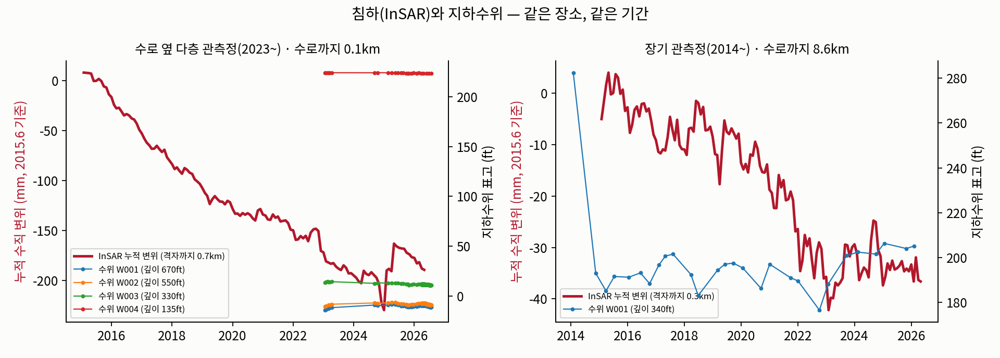

# 실제 검증 지역 자료 (California Aqueduct MP 195~215)

> 10/12 확보. 가상 대수층(synthetic/)에서 쓰던 "가짜 위성·관측정 자료" 자리에 들어갈 **실제 공개 자료**다.

## 범위

- 위도 35.50~35.78°, 경도 -119.92~-119.58° (약 31km × 31km), Kern County Subbasin 서부, Lost Hills 주변
- California Aqueduct 반복구간 Reach 9 · 10A · 11B (MP 184.8~217.8)가 지역을 북서→남동으로 지난다


## 확보한 자료

| 자료 | 내용 | 파일 |
|---|---|---|
| InSAR 수직 변위 | DWR TRE Altamira(Sentinel-1) 측정점 **74,944개**, 2015.1~2026.4, 약 6일 간격, 단위 mm | `data/insar_points_velocity.csv`(점별 속도), `data/insar_grid500m_monthly.npz`(500m 격자 3,619칸 × 136개월) |
| 지하수위 | DWR 정기 측정, 자료가 있는 관측정 **30곳**, 측정 1,831건(2014.1~2026.7) | `data/wells.csv`, `data/gwl_measurements.csv` |
| 수로 선형 | SWP 반복구간(시점·종점 이정표 포함) | `data/aqueduct_mp185_218.geojson` |
| 정밀측량점 | 수로 정밀측량 표석 83개 위치(독립 검증용 후보) | `data/precise_survey_marks.geojson` |
| 유전 경계 | CalGEM 유전 11곳(Lost Hills, Belridge 등) | `data/oil_fields_in_box.geojson` |

## 처음 본 결과

| 항목 | 값 |
|---|---|
| 지역 전체 침하 속도 | 중앙값 -6.0 mm/년, 하위 5% -37.7 mm/년 |
| 수로 2km 이내(유전 밖 268칸) 침하 속도 | 중앙값 **-15.3 mm/년**, 최대 -38.2 mm/년 |
| 수로 2km 이내 누적 침하(2015.6 → 2026.4) | 중앙값 **-60 mm**, 최대 **-256 mm** (※ 2023년 이후 InSAR는 GPS보다 침하를 작게 보여 실제보다 작을 수 있음, 아래 참고) |
| 수로 옆 다층 관측정 주변 격자 | -23.6 mm/년, 누적 -189 mm |



- 수로를 따라 11년 동안 꾸준히 침하가 진행됐다. 가상 실험의 "월 6mm 기준"과 비교하면, 연 15~38mm(월 1.3~3.2mm)라는 실제 침하 규모를 확인할 수 있다.
- 가장 강한 침하는 지역 북동쪽(밸리 바닥 농경지, 연 40~55mm)에서 나타난다. 서쪽 언덕 지대는 거의 움직이지 않는다.

## 새로 발견한 문제 두 가지

**1. 유전 침하가 섞여 있다.** 수로 2km 이내 격자 440칸 중 172칸(39%)이 Lost Hills·Belridge 유전 경계 안에 있다. 지도에서 유전 안의 길쭉한 진한 빨간 띠는 석유 생산으로 생긴 침하일 가능성이 높다. 이걸 지하수 침하로 보고 역산하면 압축성을 과대추정한다.
→ 대응: 유전 안 격자는 역산에서 빼거나(현재 통계는 제외 기준), 별도 침하원으로 모델에 넣는다.

**2. 수로 옆 관측정은 최근에 생겼다.** 수로에서 0.1km 이내 다층 관측정 4곳(깊이별 3~5개 스크린)은 2023~2025년에 설치됐다. 2014년부터 기록이 있는 장기 관측정 7곳은 수로에서 4.6~8.6km 떨어져 있다.
→ 대응: 다층 관측정은 층별 수위(CSUB 다층 모델)에 아주 좋은 자료다. 대신 수로 주변의 E2(관측정만) vs E3(+위성) 비교는 2023~2025.6 보정, 2025.7~2026.4 검증으로 기간을 맞춘다.

## 모델 역산과 GPS 검증 (10/12)

실제 자료로 MODFLOW 6 + CSUB 모델을 보정하고, 보정에 쓰지 않은 **수로 GPS로 예측을 채점**했다. 결과: [results/RESULTS.md](results/RESULTS.md)


| 방식 | 검증 기간(2023.1~2026.4) GPS 침하 오차 | 관측정 수위 오차 |
|---|---|---|
| E2 관측정만 | 54.0 mm | 12.72 m |
| **E3 관측정 + 위성** | **17.5 mm** | **3.12 m** |
| E4 + 불확실성 | 17.6 mm (90% 범위가 GPS를 30%만 포함 — 범위가 너무 좁음) | 3.12 m |

- **위성을 넣으면 실제 관측으로 확인한 예측 오차가 약 3분의 1로 줄었다.**
- E4 불확실성 범위가 너무 좁다. 가상 실험(synthetic/results_mf6)과 같은 원인: 모델 구조 오차를 반영하지 못함.

### 2023년 이후 InSAR와 GPS 불일치 (중요)

수로 GPS 5곳(NGL 처리)과 비교하면, 2015~2022년에는 InSAR와 GPS가 잘 맞지만(P544 2022.6: GPS 47mm, InSAR 38mm 침하) **2023년 이후 InSAR는 지반이 올라가는 것으로 나오고 GPS는 계속 침하한다**(P544 2025.12: GPS 72mm, InSAR 33mm). 그래서 2023년 이후 InSAR는 보정·검증에서 뺐다. 원인은 확인하지 못했다(InSAR 처리 갱신 문제로 추정).

### 실행

```bash
cd real
python3 run_real.py            # 약 10~15분 (MODFLOW 6 필요: get-modflow :flopy)
```

또는 Google Colab에서 `AquaLimit_real_colab.ipynb`를 열고 **런타임 → 모두 실행**. 셀마다 한국어 설명이 있다.

| 파일 | 역할 |
|---|---|
| `real_model.py` | 자료 읽기, MODFLOW 모델 생성·실행, 역산(가우스-뉴턴), 불확실성 앙상블, 평가 |
| `run_real.py` | E2·E3·E4 실행 → `results/` 표·그림 |
| `AquaLimit_real_colab.ipynb` | 같은 과정을 Colab에서 단계별로 실행 |
| `data/gps_monthly.csv` | GPS 5곳 월별 수직 위치(검증용) |
| `data/precip_monthly.csv` | NOAA 관측소 2곳 월 강수(함양 계산) |

## 자료 재현

```bash
cd real
python3 fetch_data.py      # 원본을 raw/에 받음(약 270MB, git 제외). InSAR는 5GB zip에서 필요한 부분만 range 요청으로 받음
python3 prepare_insar.py   # data/·figures/ 생성
```

필요 패키지: numpy, pandas, matplotlib, shapely

## 파일 해시 (수집일 2026-10-12)

| 파일 | sha256(앞 12자) |
|---|---|
| `data/SUMMARY.json` | `b687c84dbde3` |
| `data/aqueduct_mp185_218.geojson` | `31c36d037713` |
| `data/gwl_measurements.csv` | `78d58417fa00` |
| `data/insar_grid500m_cells.csv` | `1cddc97c6601` |
| `data/insar_grid500m_monthly.npz` | `d12352e11a9b` |
| `data/insar_points_velocity.csv` | `5d592ab03988` |
| `data/oil_fields_in_box.geojson` | `663666cfec7d` |
| `data/precise_survey_marks.geojson` | `0f8f5b6a2f88` |
| `data/wells.csv` | `57fec32e8ac1` |

## 출처

- DWR TRE Altamira InSAR: https://data.cnra.ca.gov/dataset/tre-altamira-insar-subsidence (단위·처리 방법: April 2026 Update 보고서)
- DWR 정기 지하수위: https://data.cnra.ca.gov/dataset/periodic-groundwater-level-measurements
- SWP 반복구간: https://data.cnra.ca.gov/dataset/i17-statewaterproject-repayment-reaches
- SWP 정밀측량점: https://data.cnra.ca.gov/dataset/i06-precise-surveys-statewaterproject
- CalGEM 유전 경계: https://data.cnra.ca.gov/dataset/oil-and-gas-field-administrative-boundaries1
- GPS 수직 위치(Nevada Geodetic Laboratory, IGS20): https://geodesy.unr.edu
- 강수(NOAA GHCN-Daily, Lost Hills USC00045151·Buttonwillow USC00041244): https://www.ncei.noaa.gov
