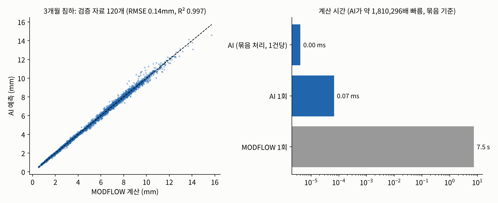

# AI 대리모델 결과

실제 지역 MODFLOW 6 + CSUB 모델(CVHM2 구조)을 흉내 내는 신경망. 입력: 땅속 성질 15개 + 계획 우물 6개 취수량, 출력: 수로 관리지점 38곳의 3개월 침하 증가와 수위 변화.

## 1. 정확도 (학습에 쓰지 않은 MODFLOW 결과와 비교)

| 항목 | 값 |
|---|---|
| 학습 자료 | MODFLOW 600회 (학습 480 / 검증 120) |
| 침하 예측 오차(RMSE) | 0.143 mm |
| 침하 설명력(R²) | 0.9972 |
| 수위 예측 오차(RMSE) | 0.0457 m |
| 계획 응답(우물 1개 최대 취수 시 추가 침하) 오차 | 0.115 mm (응답 크기 평균 0.53 mm) |

## 2. 속도

| 계산 | 시간 |
|---|---|
| MODFLOW 1회 (순차 실행) | 7.5 초 |
| AI 1회 | 0.07 ms (약 111,288배) |
| AI 묶음 처리(1건당) | 4.1 μs (약 1,810,296배) |
| 앙상블 1,000개 응답 행렬 | AI 0.1 초 / MODFLOW였다면 약 14.5 시간 |

## 3. AI로 앙상블 1,000개 강건 계획

- 비용 152천$, 외부 구매 58천 m³, 우물별 평균 취수(m³/일): A 1,618, B 2,760, C 1,255, D 656, E 1,482, F 1,382
- 이 계획을 **MODFLOW 응답(E4 구성원 30개)**으로 다시 확인: 기준 초과 확률 7%, 최대 추가 침하 평균 1.81 mm
- AI 오차가 있어서 기준선에 딱 맞춘 계획은 MODFLOW에서 조금 넘을 수 있다. 그래서 AI 오차(계획 규모 환산 0.20 mm, 90% 수준)만큼 기준을 낮춰 다시 계획: 비용 210천$, MODFLOW 확인 기준 초과 확률 **0%**.

## 4. 주의

- AI는 땅속을 직접 아는 모델이 아니라 MODFLOW를 빠르게 흉내 내는 모델이다. 학습 범위(E4 사후분포의 2배 폭, 취수 0~용량, 평년 강수) 밖에서는 정확도를 보장하지 않는다.
- 그래서 AI로 고른 최종 계획은 MODFLOW로 다시 확인한다(위 3절).

계산 시간 0.3분(학습 자료 생성 포함).
