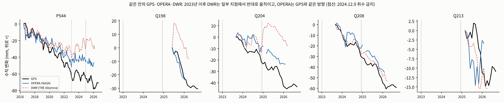
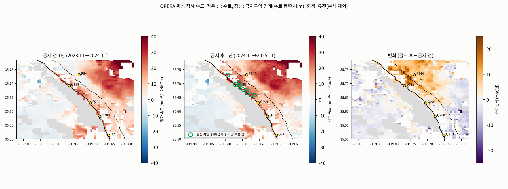

# OPERA 위성으로 본 취수 금지 전후 (관측만, 모델 없음)

자료: NASA JPL OPERA DISP-S1(Sentinel-1, 30m) 상승 1개·하강 2개 궤도 묶음 → 500m 칸 수직 변위(prepare_opera.py). 2016.7~2026.2. 대기 오차는 칸 472개(2015~2022 DWR 속도 |v|<3mm/년, 유전 밖)의 날짜별 중앙값을 빼서 줄였다. 침하 속도는 아래로 +, mm/년.

**속도는 '같은 달 → 같은 달' 연 단위로 잰다.** GPS는 여름에 올라가고 겨울에 내려가는 계절 변동이 있어(4절), 연 단위가 아닌 구간(예: 2024.12~2026.4는 겨울이 두 번)으로 재면 속도가 부풀려지거나 줄어든다. 끝점은 앞뒤 1달 포함 3개월 평균.

하강 궤도 F38503은 2021년에 받지 못한 파일 때문에 사슬이 두 번 끊겨(6일, 18일) 직전 180일 속도로 이었다. 끊긴 기간이 짧아 오차는 1mm 안팎이다.

## 1. 자료 품질: 같은 칸의 GPS vs OPERA vs DWR

### 2023.1~2026.2 누적 변화 (DWR를 버린 구간)

| GPS | 개월 | GPS 속도 | OPERA 속도 | DWR 속도 | OPERA 오차(RMSE) | DWR 오차(RMSE) |
|---|---|---|---|---|---|---|
| P544 | 38 | 3.1 | 1.5 | -4.9 | 9.7 | 17.0 |
| Q198 | 9 | 37.1 | 37.2 | 17.5 | 4.0 | 19.3 |
| Q204 | 30 | 15.8 | 11.3 | -3.8 | 11.5 | 25.2 |
| Q208 | 30 | 20.9 | 17.7 | 18.0 | 8.3 | 4.3 |
| Q213 | 12 | 10.8 | 5.0 | 14.6 | 8.2 | 5.4 |

- 침하 방향이 GPS와 같은 지점: **OPERA 5/5곳, DWR 3/5곳**. DWR는 P544·Q204에서 2023년 이후 땅이 올라간 것으로 나온다(GPS는 침하).
- 누적 곡선 오차 중앙값: **OPERA 8.3mm, DWR 17.0mm**. OPERA 속도는 GPS보다 조금 작게 나오는 경향이 있다(500m 칸 평균이라 수로 바로 옆 국지 침하가 희석되고, 기준 칸도 조금 움직일 수 있음).

### 연 단위 속도 (mm/년)

| GPS | 구간 | GPS | OPERA | DWR |
|---|---|---|---|---|
| P544 | 2020.11→2022.11 가뭄(배분율 5~20%) | 9.0 | 6.8 | 3.2 |
| P544 | 2023.11→2024.11 금지 전 1년(배분율 40%) | 5.2 | -0.8 | 0.5 |
| P544 | 2024.11→2025.11 금지 후 1년(배분율 50%) | 6.8 | 6.7 | -1.6 |
| Q204 | 2023.11→2024.11 금지 전 1년(배분율 40%) | 15.4 | 11.5 | 10.3 |
| Q204 | 2024.11→2025.11 금지 후 1년(배분율 50%) | 15.9 | 12.5 | -11.2 |
| Q208 | 2023.11→2024.11 금지 전 1년(배분율 40%) | 20.9 | 19.1 | 18.4 |
| Q208 | 2024.11→2025.11 금지 후 1년(배분율 50%) | 21.9 | 19.5 | 18.8 |

## 2. 구역별 침하 속도 (유전 칸 제외, 500m 칸 중앙값, mm/년)

| 구역 | 500m 칸 | 2020.11→2022.11 가뭄(배분율 5~20%) | 2023.11→2024.11 금지 전 1년(배분율 40%) | **2024.11→2025.11 금지 후 1년(배분율 50%)** | 금지 후 기준(연 12.7mm) 초과 칸 | 금지 후 빨라진 칸 |
|---|---|---|---|---|---|---|
| 수로 1km 안 | 197 | 19.3 | 15.0 | **16.7** | 67% | 75% |
| 금지구역(수로 동쪽 4km 안) | 544 | 15.7 | 8.2 | **12.2** | 47% | 76% |
| 금지구역 밖(동쪽 4~10km) | 738 | 21.9 | 9.9 | **13.4** | 52% | 62% |

### 금지 효과: 금지구역 안 vs 밖 (이중차분)

금지 전 1년(배분율 40%)과 금지 후 1년(배분율 50%)은 수로 물 사정이 비슷하다. 금지가 지켜졌다면 **금지구역 안**은 밖보다 침하가 더 줄었어야 한다.

| | 금지 후 − 금지 전 (mm/년, 1km 묶음 중앙값) |
|---|---|
| 금지구역 안 (150칸) | +5.1 |
| 금지구역 밖 (202칸) | +2.3 |
| **안 − 밖 (금지 효과)** | **+2.9** (90% 범위 +0.6~+4.5) |

- 금지구역 안이 밖보다 **덜 줄지 않았다**(차이가 0 이상). 위성으로는 금지 효과가 보이지 않는다 → 금지구역 안 취수가 계속됐거나, 과거 취수로 늦게 눌리는 점토가 금지 효과를 가렸다.
- 늦게 눌리는 점토(지연 압밀)는 수로 가까운 남쪽에서 크다(모델 v3: 남쪽이 4배 느림). 이 몫은 모델 원인 분해로만 나눌 수 있다.

## 3. 현장 확인 후보: 금지구역 안에서 금지 후 가장 빨리 꺼지는 1km 칸

| 순위 | 위도 | 경도 | 수로까지 (km) | 금지 전 1년 | 금지 후 1년 | 변화 |
|---|---|---|---|---|---|---|
| 1 | 35.6780 | -119.7487 | 0.5 | 27.2 | **32.6** | +5.5 |
| 2 | 35.6960 | -119.7708 | 0.2 | 25.8 | **32.6** | +6.8 |
| 3 | 35.7028 | -119.7597 | 1.4 | 15.2 | **31.4** | +16.1 |
| 4 | 35.6938 | -119.7597 | 0.6 | 23.9 | **30.7** | +6.8 |
| 5 | 35.6848 | -119.7570 | 0.1 | 19.6 | **28.8** | +9.2 |
| 6 | 35.6675 | -119.7367 | 0.2 | 22.7 | **26.9** | +4.2 |
| 7 | 35.7298 | -119.7929 | 0.6 | 19.5 | **26.7** | +7.1 |
| 8 | 35.6585 | -119.7256 | 0.3 | 20.8 | **25.7** | +4.9 |
| 9 | 35.6577 | -119.7155 | 1.0 | 20.3 | **25.6** | +5.2 |
| 10 | 35.6758 | -119.7376 | 0.8 | 23.1 | **25.4** | +2.2 |

금지구역 안은 취수가 0이어야 하므로, 금지 후에도 빠르게 꺼지는 칸은 (1) 과거 취수로 늦게 눌리는 점토, (2) 금지구역 밖 취수의 영향, (3) 금지구역 안 미계량 취수 중 하나다. 위성만으로는 셋을 나눌 수 없고, 모델 원인 분해(results_validate_v3ops)와 함께 본다. 관리기관에는 '유량계·전력 사용량을 먼저 확인할 곳' 목록으로 준다.

## 4. GPS의 계절 변동

| GPS | 기간 | GPS 수직 변화 (mm, 위로 +) | OPERA 같은 칸 |
|---|---|---|---|
| P544 | 2025 여름(4→9월) | 8.7 | -2.6 |
| P544 | 2025~26 겨울(9→2월) | -14.7 | 3.8 |
| P544 | 2026 여름(4→9월, OPERA 자료 없음) | 6.1 | - |
| Q198 | 2025 여름(4→9월) | - | -11.1 |
| Q198 | 2025~26 겨울(9→2월) | -20.4 | -13.3 |
| Q198 | 2026 여름(4→9월, OPERA 자료 없음) | -1.8 | - |
| Q204 | 2025 여름(4→9월) | 3.4 | -8.5 |
| Q204 | 2025~26 겨울(9→2월) | -18.7 | -4.6 |
| Q204 | 2026 여름(4→9월, OPERA 자료 없음) | 0.6 | - |
| Q208 | 2025 여름(4→9월) | 0.7 | -8.5 |
| Q208 | 2025~26 겨울(9→2월) | -19.4 | -12.0 |
| Q208 | 2026 여름(4→9월, OPERA 자료 없음) | -0.7 | - |
| Q213 | 2025 여름(4→9월) | 3.8 | -14.0 |
| Q213 | 2025~26 겨울(9→2월) | -13.2 | 11.2 |
| Q213 | 2026 여름(4→9월, OPERA 자료 없음) | 2.4 | - |

- GPS는 여름에 올라가고 겨울에 크게 내려간다. 같은 칸의 OPERA는 여름(관개기)에 내려간다. GPS(지구 기준 절대 위치)에는 넓은 지역이 함께 움직이는 계절 변형(지표 물·눈 무게에 따른 탄성 변형 등)이 들어가고, 주변 기준 칸을 빼는 InSAR에서는 빠지는 것으로 보인다. 원인은 확인하지 못했다.
- **판정은 연 단위로 해야 한다.** 3개월 GPS 변화로 연 0.5인치 기준을 판정하면 계절 변동에 속는다. AquaLimit의 3개월 계획 한도는 모델로 계산한 '계획으로 인한 추가 침하'라 이 문제와 별개다.
- 10/28 발표 초안의 '금지 후 오히려 빨라졌다'(Q204 13.0→17.5, Q208 18.5→22.4mm/년)는 연 단위가 아닌 구간이라 계절 변동이 섞였다. 연 단위로 다시 재면 **금지 후에도 줄지 않았다**(1절 표)가 정확한 표현이다.

## 5. 밭은 금지 후에도 계속 물을 썼나 (Landsat NDVI)

| 연도 | 금지구역 안 농경지 | 금지구역 밖(4~10km) | 수로 물 배분율 |
|---|---|---|---|
| 2019 | 0.324 | 0.237 | 75% |
| 2020 | 0.334 | 0.231 | 20% |
| 2021 | 0.329 | 0.215 | 5% |
| 2022 | 0.322 | 0.217 | 5% |
| 2023 | 0.375 | 0.299 | 100% |
| 2024 | 0.359 | 0.255 | 40% |
| 2025 (금지 후) | 0.356 | 0.231 | 50% |
| 2026 (금지 후) | 0.391 | 0.266 | 45% |

- 관개기(5~9월) 평균 NDVI. 금지 후(2025·2026)에도 금지구역 안 밭의 녹색도가 줄지 않았다 → 휴경하지 않고 계속 물을 썼다. 그 물이 지하수인지 수로 물·외부 구입 물인지는 위성으로 알 수 없다(과수원은 휴경이 어렵다). 계량·수로 물 배달 기록으로 확인할 부분이다.

## 6. 한계

- 500m 칸 평균, 수직·동서 두 성분만 풀었다(남북 성분 무시). 2016.7 이전은 DWR 자료로 이어 붙였다. OPERA는 2026.2까지(그 뒤 자료는 아직 받지 못함).
- 금지 전후 비교는 1년씩이다. 해마다 기상·작물이 달라 1년 차이에는 잡음이 있다.
- 출처: OPERA DISP-S1 v1.0, NASA JPL/ASF DAAC. https://www.jpl.nasa.gov/go/opera
