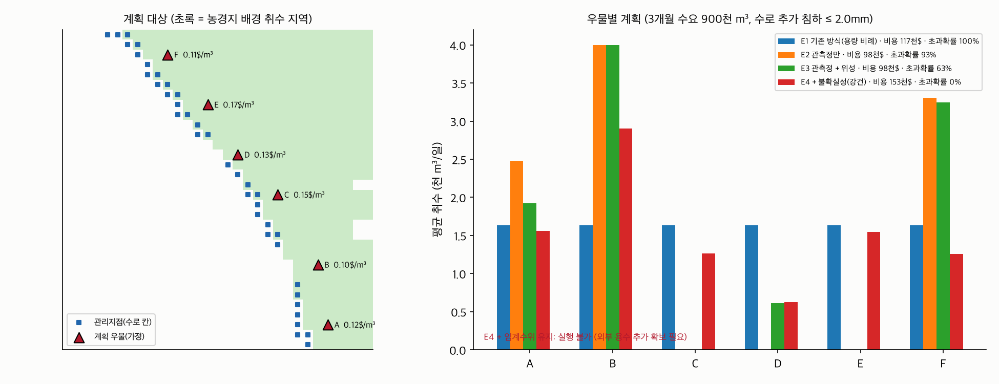

# 실제 검증 지역 취수 계획 (2026년 5~7월, 시뮬레이션)

수로 동쪽 3km 가상 사업자 우물 6개(용량 각 4,000 m³/일), 3개월 수요 900,000 m³, 외부 용수 0.81$/m³(한도 300,000 m³). 관리 기준: 계획으로 인한 수로 칸(38곳) 추가 침하 ≤ **2.0mm/3개월**. 참고로 배경 침하(다른 농가 취수)만으로 수로 칸 중앙값 2.7mm, 최대 6.7mm가 3개월 동안 생긴다.

우물 위치·용량·비용은 가정값이다(관정별 실제 기록 비공개). 땅속 성질·배경 취수·함양은 실제 자료로 역산한 값(이전 버전, results_uniform/)을 쓴다. 실제 정답이 없으므로, 각 계획을 **E4 앙상블 30개 모두에서** 계산해 기준 초과 확률로 비교한다. 주의: E4 계획은 바로 이 30개 모두에서 기준을 지키도록 만든 것이라 **E4의 0%는 정의상 0%**다(표본 내 값). 계획에 쓰지 않은 땅속 상태 30개로 다시 잰 값은 [RESULTS_oos.md](RESULTS_oos.md)를 본다.

## 1. 계획 비교

| 방식 | 실행 가능 | 총비용(천$) | 외부 구매(천 m³) | 최대 추가 침하 평균(mm) | 상위 5% (mm) | 기준 초과 확률(계획에 쓴 30개) | 임계수위 아래로 내려갈 확률 |
|---|---|---|---|---|---|---|---|
| E1 기존 방식(용량 비례) | 가능 | 117 | 0 | 3.02 | 3.35 | 100% | 100% |
| E2 관측정만 | 가능 | 98 | 0 | 2.52 | 2.92 | 93% | 100% |
| E3 관측정 + 위성 | 가능 | 98 | 0 | 2.11 | 2.38 | 63% | 100% |
| E4 + 불확실성(강건) | 가능 | 153 | 58 | 1.79 | 1.97 | 0% | 100% |
| E4 + 임계수위 유지 | 불가 (다른 농가 취수만으로도 이미 과거 최저 수위 아래입니다. 이 사업자의 계획만으로는 임계수위를 지킬 수 없고, 지역 전체 취수 조정이 필요합니다.) | - | - | - | - | - | - |

**임계수위(과거 최저 수위)는 이 사업자의 계획으로 지킬 수 없다.** 계획 우물을 하나도 안 돌리고 수요 전량을 외부에서 사도, 다른 농가의 배경 취수만으로 수로 칸 수위가 이미 과거 최저보다 낮다. 그래서 모든 계획에서 '임계수위 아래로 내려갈 확률'이 100%로 나온다. **지역 전체(지하수 관리기관) 차원의 취수 조정이 필요하다**. (이전 판의 '외부 용수 900천 m³를 사면 지킨다'는 코드 오류로 잘못 나온 문장이라 고쳤다.)

### 해석

- **E1(용량 비례)**은 모델 없이 고르게 뽑아 비용 117천$, 기준 초과 확률 100%.
- **E3(위성 + 추정값 1개)**는 싸고 침하 영향이 작은 우물로 옮겨 비용을 98천$로 줄이지만, 기준선에 딱 맞춰 계획해서 초과 확률이 63%다. 실제로 MODFLOW로 직접 돌리면 최대 2.13mm로 기준(2mm)을 넘는다(2절).
- **E4(불확실성 반영)**는 외부 용수 58천 m³를 사서 비용이 153천$(E3보다 56% 높음)이지만, 앙상블 30개 모두에서 기준을 지킨다(초과 확률 0%).
- 가상 대수층 실험(synthetic/)과 같은 결론이 실제 지역 모델에서도 나왔다: 추정값 하나만 믿으면 기준선에 붙고, 불확실성을 반영하면 비용을 더 써서(이 조건에서는 외부 용수 구매 때문에 비용 증가가 가상 실험보다 크다) 위험을 없앤다.

## 2. 응답 행렬(선형 근사) 확인

E3 모델에서 계획을 MODFLOW로 직접 실행한 결과와 응답 행렬 예측을 비교했다.

| 계획 | 직접 실행 최대 침하 | 응답 행렬 예측 | 최대 차이 |
|---|---|---|---|
| E3 관측정 + 위성 | 2.13 mm | 2.00 mm | 0.142 mm |
| E4 + 불확실성(강건) | 1.67 mm | 1.73 mm | 0.094 mm |

## 3. 실행 불가 판정

| 입력 | 결과 |
|---|---|
| 수요 1.5배 · 기준 그대로 | 실행 불가 — 침하·수위 기준을 지키면서 수요를 채울 수 없습니다. 추가 용수 확보가 필요합니다. |
| 수요 그대로 · 기준 0.3mm | 실행 불가 — 침하·수위 기준을 지키면서 수요를 채울 수 없습니다. 추가 용수 확보가 필요합니다. |
| 수요 3배 (우물 용량+구매 한도 2,508천 m³ 초과) | 실행 불가 — 우물 용량과 외부 구매 한도를 모두 써도 수요를 채울 수 없습니다. |

계산 시간 17.5분.
