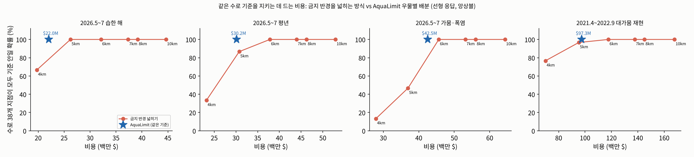

# 금지 반경 넓히기 vs AquaLimit (같은 기준, 비용 비교)

policy_real.py의 앙상블 선형 응답(구성원별 '우물 묶음 취수 → 수로 38개 지점 침하')으로 계산했다. 기준: 연 0.5인치(12.7mm)를 기간 길이로 나눈 값. '모든 지점 기준 확률' = 앙상블 구성원 중 수로 38개 지점이 모두 기준 안인 비율. AquaLimit 계획은 모든 구성원·모든 지점에서 기준을 지키게 만든 것이라 이 값이 100%다.

**주의:** 선형 응답 값이다. policy_real.py의 MODFLOW 확인에서 'AquaLimit 규제 기준' 계획의 모든 지점 기준 확률은 평년 60%, 가뭄 60%, 습한 해 80%, 대가뭄 97%로 선형 예측(100%)보다 낮았다(비선형). 금지 반경 안들도 같은 방향으로 낮아질 것이므로 비교(누가 더 싼가)는 유지되지만, 금지 확대 안의 MODFLOW 확인은 맥에서 policy_real.py에 추가해 돌려야 한다.

## 요약: 모든 수로 지점에서 기준을 지키는 데 드는 비용 (백만 $)

| 상황 | 금지: 그 해에 맞는 최소 반경 | 금지: 고정 반경 6.0km(가뭄에도 지키는 규칙) | **AquaLimit** | 절약 (최소 반경 대비) | 절약 (고정 규칙 대비) |
|---|---|---|---|---|---|
| 2021.4~2022.9 대가뭄 재현 | 5.6km $112.3M | $117.7M | **$97.3M** | $15.0M (13%) | $20.4M (17%) |
| 2026.5~7 습한 해 | 4.7km $25.3M | $32.1M | **$22.0M** | $3.3M (13%) | $10.1M (31%) |
| 2026.5~7 평년 | 5.3km $32.7M | $37.8M | **$30.2M** | $2.6M (8%) | $7.7M (20%) |
| 2026.5~7 가뭄·폭염 | 6.0km $45.6M | $45.6M | **$42.5M** | $3.2M (7%) | $3.2M (7%) |

- 금지 반경은 한 번 정하면 해마다 바꾸기 어렵다. 가뭄 해에도 기준을 지키려면 반경을 가뭄에 맞춰야 하고, 그러면 평년·습한 해에는 필요 이상으로 멈춘다.
- AquaLimit은 그해 날씨·수로 배분율에 맞춰 우물별로 줄일 양을 다시 계산한다. 같은 기준을 지키면서 위 표만큼 덜 쓴다.
- '최소 반경' 열은 그해 날씨를 미리 알고 반경을 0.1km 단위로 가장 유리하게 고른 경우다(현실에서는 모델 없이 고를 수 없다).

## 2021.4~2022.9 대가뭄 재현 (기준 19.1mm/18개월)

| 정책 | 멈춘 취수 비율 | 대체 용수 (백만 m³) | 비용 (백만 $) | 기준 지키는 지점 | 모든 지점 기준 확률 | 최악 지점 침하 (mm, 중앙값) |
|---|---|---|---|---|---|---|
| 금지 4km(실제) | 36% | 75.1 | 70.0 | 100% | 77% | 16.7 |
| 금지 5km | 53% | 109.0 | 95.3 | 100% | 97% | 6.9 |
| 금지 6km | 67% | 139.1 | 117.7 | 100% | 100% | 0.6 |
| 금지 7km | 80% | 166.1 | 137.7 | 100% | 100% | -0.2 |
| 금지 8km | 85% | 175.8 | 145.0 | 100% | 100% | -0.3 |
| 금지 10km | 100% | 207.2 | 167.8 | 100% | 100% | -0.4 |
| 금지 5.6km(기준 맞추는 최소 반경) | 64% | 131.9 | 112.3 | 100% | 100% | 2.0 |
| AquaLimit 규제 기준 | 54% | 112.4 | 97.3 | 100% | 100% | 7.4 |

- 기준을 모든 지점에서 지키는 가장 작은 금지: **금지 5.6km(기준 맞추는 최소 반경)**, $112.3M. AquaLimit: **$97.3M** → **$15.0M 절약(13%)**.

## 2026.5~7 습한 해 (기준 3.2mm/3개월)

| 정책 | 멈춘 취수 비율 | 대체 용수 (백만 m³) | 비용 (백만 $) | 기준 지키는 지점 | 모든 지점 기준 확률 | 최악 지점 침하 (mm, 중앙값) |
|---|---|---|---|---|---|---|
| 금지 4km(실제) | 39% | 21.5 | 19.8 | 100% | 67% | 3.0 |
| 금지 5km | 55% | 30.2 | 26.2 | 100% | 100% | -0.2 |
| 금지 6km | 69% | 38.1 | 32.1 | 100% | 100% | -0.8 |
| 금지 7km | 82% | 45.1 | 37.3 | 100% | 100% | -0.9 |
| 금지 8km | 86% | 47.6 | 39.2 | 100% | 100% | -1.0 |
| 금지 10km | 100% | 55.1 | 44.6 | 100% | 100% | -1.2 |
| 금지 4.7km(기준 맞추는 최소 반경) | 53% | 29.0 | 25.3 | 100% | 100% | 0.2 |
| AquaLimit 규제 기준 | 45% | 24.6 | 22.0 | 100% | 100% | 1.4 |

- 기준을 모든 지점에서 지키는 가장 작은 금지: **금지 4.7km(기준 맞추는 최소 반경)**, $25.3M. AquaLimit: **$22.0M** → **$3.3M 절약(13%)**.

## 2026.5~7 평년 (기준 3.2mm/3개월)

| 정책 | 멈춘 취수 비율 | 대체 용수 (백만 m³) | 비용 (백만 $) | 기준 지키는 지점 | 모든 지점 기준 확률 | 최악 지점 침하 (mm, 중앙값) |
|---|---|---|---|---|---|---|
| 금지 4km(실제) | 39% | 25.2 | 23.2 | 61% | 33% | 5.2 |
| 금지 5km | 54% | 35.3 | 30.8 | 100% | 87% | 1.2 |
| 금지 6km | 69% | 44.8 | 37.8 | 100% | 100% | -0.6 |
| 금지 7km | 81% | 53.1 | 44.0 | 100% | 100% | -0.8 |
| 금지 8km | 86% | 56.2 | 46.3 | 100% | 100% | -1.0 |
| 금지 10km | 100% | 65.3 | 52.9 | 100% | 100% | -1.1 |
| 금지 5.3km(기준 맞추는 최소 반경) | 58% | 38.0 | 32.7 | 100% | 100% | 0.2 |
| AquaLimit 규제 기준 | 53% | 34.6 | 30.2 | 100% | 100% | 1.3 |

- 기준을 모든 지점에서 지키는 가장 작은 금지: **금지 5.3km(기준 맞추는 최소 반경)**, $32.7M. AquaLimit: **$30.2M** → **$2.6M 절약(8%)**.

## 2026.5~7 가뭄·폭염 (기준 3.2mm/3개월)

| 정책 | 멈춘 취수 비율 | 대체 용수 (백만 m³) | 비용 (백만 $) | 기준 지키는 지점 | 모든 지점 기준 확률 | 최악 지점 침하 (mm, 중앙값) |
|---|---|---|---|---|---|---|
| 금지 4km(실제) | 38% | 30.2 | 27.9 | 45% | 13% | 10.7 |
| 금지 5km | 53% | 42.4 | 37.0 | 84% | 47% | 3.8 |
| 금지 6km | 68% | 54.0 | 45.6 | 100% | 100% | 0.5 |
| 금지 7km | 81% | 64.1 | 53.1 | 100% | 100% | -0.8 |
| 금지 8km | 86% | 68.0 | 56.0 | 100% | 100% | -1.1 |
| 금지 10km | 100% | 79.4 | 64.3 | 100% | 100% | -1.3 |
| 금지 5.9km(기준 맞추는 최소 반경) | 68% | 54.0 | 45.6 | 100% | 100% | 0.5 |
| AquaLimit 규제 기준 | 63% | 50.0 | 42.5 | 100% | 100% | 1.3 |

- 기준을 모든 지점에서 지키는 가장 작은 금지: **금지 6km**, $45.6M. AquaLimit: **$42.5M** → **$3.2M 절약(7%)**.

