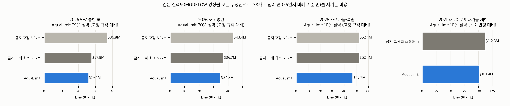

# MODFLOW로 고친 AquaLimit 계획 vs MODFLOW로 찾은 금지 반경 (같은 신뢰도)

기준: 연 0.5인치(12.7mm)를 기간 길이로 나눈 값. **신뢰도 = MODFLOW 앙상블 모든 구성원에서 수로 38개 지점이 모두 기준 안**(과거 재현 30개, 다음 관개기 15개 구성원). AquaLimit은 선형 계획을 MODFLOW로 확인하고, 구성원·지점별로 'MODFLOW 침하 변화 ÷ 선형 예측 변화' 비율만큼 응답을 고쳐 다시 풀었다(순차 선형 계획, 최대 6회). 처음 쓴 방식(차이를 더하기)은 4회 보정 뒤에도 평년·가뭄에서 15개 중 1개 구성원이 기준을 넘어(93%) 비율 보정으로 바꿨다(refine.json의 aqualimit_iters_additive). 금지 반경은 MODFLOW로 직접 돌려 기준을 지키는 가장 작은 반경을 0.1km 단위로 찾았다.

## 요약: 같은 신뢰도(MODFLOW 모든 지점 기준 달성)에 드는 비용 (백만 $)

| 상황 | 금지: 그해 최소 반경 | 금지: 고정 규칙 6.9km | **AquaLimit (MODFLOW 보정)** | 절약 (최소 반경 대비) | 절약 (고정 규칙 대비) |
|---|---|---|---|---|---|
| 2021.4~2022.9 대가뭄 재현 | 5.6km $112.3M | - | **$101.4M** | $10.9M (10%) | - |
| 2026.5~7 습한 해 | 5.3km $27.9M | $36.8M | **$26.1M** | $1.8M (7%) | $10.8M (29%) |
| 2026.5~7 평년 | 5.7km $36.7M | $43.4M | **$34.8M** | $1.9M (5%) | $8.6M (20%) |
| 2026.5~7 가뭄·폭염 | 6.9km $52.4M | $52.4M | **$47.2M** | $5.3M (10%) | $5.3M (10%) |

- '그해 최소 반경'은 그해 날씨를 미리 알고 반경을 0.1km 단위로 가장 유리하게 고른 경우다. 현실의 금지 규칙은 해마다 바꾸기 어려워 '고정 규칙'에 가깝다.
- 고정 규칙 비용은 반경이 그해 최소 반경 이상이라 기준을 지킨다(반경이 넓을수록 침하가 작다).

## 2021.4~2022.9 대가뭄 재현 (기준 19.1mm, MODFLOW 계획 12개 × 구성원 30개)

| 계획 | 비용 (백만 $) | 멈춘·대체 용수 (백만 m³) | MODFLOW 모든 지점 확률 | 지점별 중앙값 기준 안 | 최악 지점 (mm, 중앙값 / 상위 5%) |
|---|---|---|---|---|---|
| AquaLimit 선형 계획 | 97.3 | 112.4 | 97% | 100% | 9.3 / 17.0 |
| AquaLimit 보정 1회 | 100.4 | 116.5 | 97% | 100% | 8.5 / 15.9 |
| AquaLimit 보정 2회 | 101.2 | 117.5 | 97% | 100% | 8.4 / 15.6 |
| AquaLimit 보정 3회 | 101.4 | 117.8 | 100% | 100% | 8.3 / 15.5 |
| 금지 5.2km | 97.2 | 111.6 | 93% | 100% | 10.8 / 18.1 |
| 금지 5.4km | 105.1 | 122.1 | 97% | 100% | 9.2 / 15.1 |
| 금지 5.5km | 105.1 | 122.1 | 97% | 100% | 9.2 / 15.1 |
| 금지 5.6km | 112.3 | 131.9 | 100% | 100% | 7.0 / 12.0 |

## 2026.5~7 습한 해 (기준 3.2mm, MODFLOW 계획 14개 × 구성원 15개)

| 계획 | 비용 (백만 $) | 멈춘·대체 용수 (백만 m³) | MODFLOW 모든 지점 확률 | 지점별 중앙값 기준 안 | 최악 지점 (mm, 중앙값 / 상위 5%) |
|---|---|---|---|---|---|
| AquaLimit 선형 계획 | 22.0 | 24.6 | 80% | 100% | 2.7 / 5.3 |
| AquaLimit 보정 1회 | 25.0 | 28.5 | 93% | 100% | 1.8 / 3.3 |
| AquaLimit 보정 2회 | 25.8 | 29.7 | 93% | 100% | 1.6 / 3.0 |
| AquaLimit 보정 3회 | 26.1 | 30.1 | 100% | 100% | 1.5 / 2.9 |
| 금지 4.7km | 25.3 | 29.0 | 87% | 100% | 2.0 / 3.6 |
| 금지 5.1km | 26.2 | 30.2 | 93% | 100% | 1.6 / 3.1 |
| 금지 5.2km | 26.7 | 30.9 | 93% | 100% | 1.4 / 2.9 |
| 금지 5.3km | 27.9 | 32.5 | 100% | 100% | 0.9 / 2.3 |
| 금지 5.5km | 28.8 | 33.7 | 100% | 100% | 0.6 / 1.9 |

## 2026.5~7 평년 (기준 3.2mm, MODFLOW 계획 13개 × 구성원 15개)

| 계획 | 비용 (백만 $) | 멈춘·대체 용수 (백만 m³) | MODFLOW 모든 지점 확률 | 지점별 중앙값 기준 안 | 최악 지점 (mm, 중앙값 / 상위 5%) |
|---|---|---|---|---|---|
| AquaLimit 선형 계획 | 30.2 | 34.6 | 60% | 100% | 3.0 / 5.7 |
| AquaLimit 보정 1회 | 33.3 | 38.8 | 87% | 100% | 1.9 / 3.8 |
| AquaLimit 보정 2회 | 34.4 | 40.3 | 93% | 100% | 1.7 / 3.1 |
| AquaLimit 보정 3회 | 34.8 | 40.9 | 100% | 100% | 1.6 / 3.0 |
| 금지 5.3km | 32.7 | 38.0 | 80% | 100% | 2.3 / 4.6 |
| 금지 5.5km | 33.8 | 39.5 | 87% | 100% | 2.0 / 4.2 |
| 금지 5.6km | 36.1 | 42.5 | 93% | 100% | 1.3 / 2.9 |
| 금지 5.7km | 36.7 | 43.3 | 100% | 100% | 1.1 / 2.7 |

## 2026.5~7 가뭄·폭염 (기준 3.2mm, MODFLOW 계획 16개 × 구성원 15개)

| 계획 | 비용 (백만 $) | 멈춘·대체 용수 (백만 m³) | MODFLOW 모든 지점 확률 | 지점별 중앙값 기준 안 | 최악 지점 (mm, 중앙값 / 상위 5%) |
|---|---|---|---|---|---|
| AquaLimit 선형 계획 | 42.5 | 50.0 | 60% | 100% | 3.0 / 5.8 |
| AquaLimit 보정 1회 | 45.4 | 53.9 | 80% | 100% | 1.9 / 4.2 |
| AquaLimit 보정 2회 | 46.4 | 55.3 | 87% | 100% | 1.7 / 3.4 |
| AquaLimit 보정 3회 | 46.9 | 56.0 | 93% | 100% | 1.6 / 3.1 |
| AquaLimit 보정 4회 | 47.2 | 56.3 | 100% | 100% | 1.6 / 3.0 |
| 금지 6.0km | 45.6 | 54.0 | 73% | 100% | 2.6 / 5.0 |
| 금지 6.4km | 47.8 | 57.0 | 87% | 100% | 1.5 / 3.6 |
| 금지 6.8km | 49.1 | 58.7 | 93% | 100% | 1.1 / 3.0 |
| 금지 6.9km | 52.4 | 63.2 | 100% | 100% | 0.3 / 1.6 |
| 금지 7.0km | 53.1 | 64.1 | 100% | 100% | 0.1 / 1.3 |
| 금지 7.2km | 53.1 | 64.1 | 100% | 100% | 0.1 / 1.3 |

계산 시간 7.6분.
