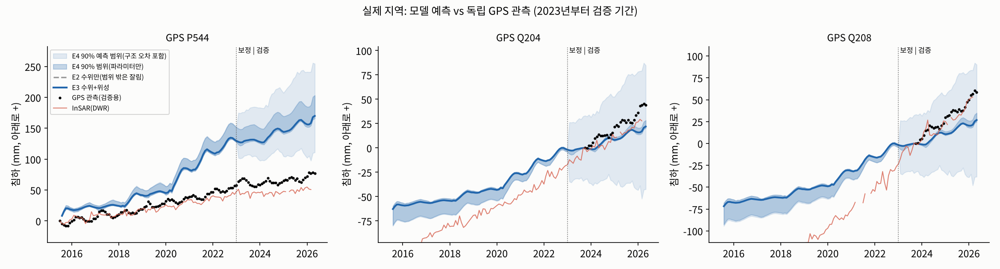

# 운영 모델 (v3ops-opera): 2015.7~2026.4 모든 자료로 보정

계획·정책 비교·AI에 쓰는 모델이다. NASA OPERA 위성(2015.7~2026.2, 2016.7 전은 DWR) + 관측정 수위(전 기간) + 수로 GPS(2023~2026.4)로 보정했다. GPS를 보정에 썼으므로 아래 GPS 오차는 **검증 점수가 아니라 적합도**다. 예측 성능은 검증 모델(results_v3/)로 말한다.

| 항목 | 값 |
|---|---|
| InSAR 적합 RMSE (2015~2026.2) | 45.5 mm |
| GPS 적합 RMSE (2023~2026.4) | 16.5 mm |
| 수위 RMSE (2023~2026.4) | 2.88 m |

| 파라미터 | 사전값 | E3 (±1σ) |
|---|---|---|
| mSk_z0 | 1 | 0.0316 (±0.18) |
| mSk_z1 | 1 | 1.82 (±0.12) |
| mSk_z2 | 1 | 1.46 (±0.11) |
| mSk_z3 | 1 | 0.0316 (±0.14) |
| mSk_z4 | 1 | 0.861 (±0.10) |
| mSk_z5 | 1 | 1.22 (±0.10) |
| mSk_z6 | 1 | 0.0316 (±0.13) |
| mSk_z7 | 1 | 0.714 (±0.10) |
| mSk_z8 | 1 | 3.85 (±0.12) |
| Kc | 20 | 181 (±0.17) |
| Kf | 0.02 | 0.317 (±0.56) |
| Kcorc | 1.01e-05 | 0.00273 (±0.20) |
| pump | 0.1 | 0.0429 (±0.24) |
| dry_beta | 0.50 | 0.31 (±0.33) |
| pmult | 1 | 0.711 (±0.11) |
| sw | 0.3 | 0.264 (±0.10) |
| rch | 0.05 | 0.00889 (±1.47) |
| rf | 0.15 | 0.423 (±0.11) |
| Kvdb | 1e-05 | 1.6e-06 (±0.11) |
| Kvdb_s | 1e-05 | 4.44e-07 (±0.10) |
| spin | 1 | 0.583 (±0.05) |
| post_in | 1 | 1.08 (±0.05) |
| post_out | 1 | 1.23 (±0.03) |

계산 시간 23.2분.
