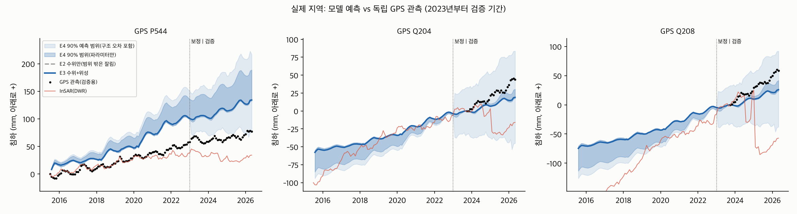

# 운영 모델 (v3ops): 2015.7~2026.4 모든 자료로 보정

계획·정책 비교·AI에 쓰는 모델이다. InSAR(2015.7~2022.12) + 관측정 수위(전 기간) + 수로 GPS(2023~2026.4)로 보정했다. GPS를 보정에 썼으므로 아래 GPS 오차는 **검증 점수가 아니라 적합도**다. 예측 성능은 검증 모델(results_v3/)로 말한다.

| 항목 | 값 |
|---|---|
| InSAR 적합 RMSE (2015~2022) | 28.5 mm |
| GPS 적합 RMSE (2023~2026.4) | 16.5 mm |
| 수위 RMSE (2023~2026.4) | 2.87 m |

| 파라미터 | 사전값 | E3 (±1σ) |
|---|---|---|
| mSk_z0 | 1 | 0.0316 (±0.21) |
| mSk_z1 | 1 | 1.18 (±0.10) |
| mSk_z2 | 1 | 2.22 (±0.10) |
| mSk_z3 | 1 | 0.0316 (±0.15) |
| mSk_z4 | 1 | 0.962 (±0.09) |
| mSk_z5 | 1 | 1.27 (±0.09) |
| mSk_z6 | 1 | 0.0491 (±0.12) |
| mSk_z7 | 1 | 0.643 (±0.09) |
| mSk_z8 | 1 | 2.76 (±0.10) |
| Kc | 20 | 222 (±0.19) |
| Kf | 0.02 | 0.317 (±0.60) |
| Kcorc | 1.01e-05 | 0.0033 (±0.21) |
| pump | 0.1 | 0.0386 (±0.23) |
| dry_beta | 0.50 | 1.41 (±0.58) |
| pmult | 1 | 0.705 (±0.13) |
| sw | 0.3 | 0.165 (±0.13) |
| rch | 0.05 | 0.00889 (±1.22) |
| rf | 0.15 | 0.423 (±0.15) |
| Kvdb | 1e-05 | 1.37e-06 (±0.09) |
| Kvdb_s | 1e-05 | 3.9e-07 (±0.08) |
| spin | 1 | 0.619 (±0.05) |
| post_in | 1 | 1.36 (±0.08) |
| post_out | 1 | 0.902 (±0.10) |

계산 시간 5.1분.
