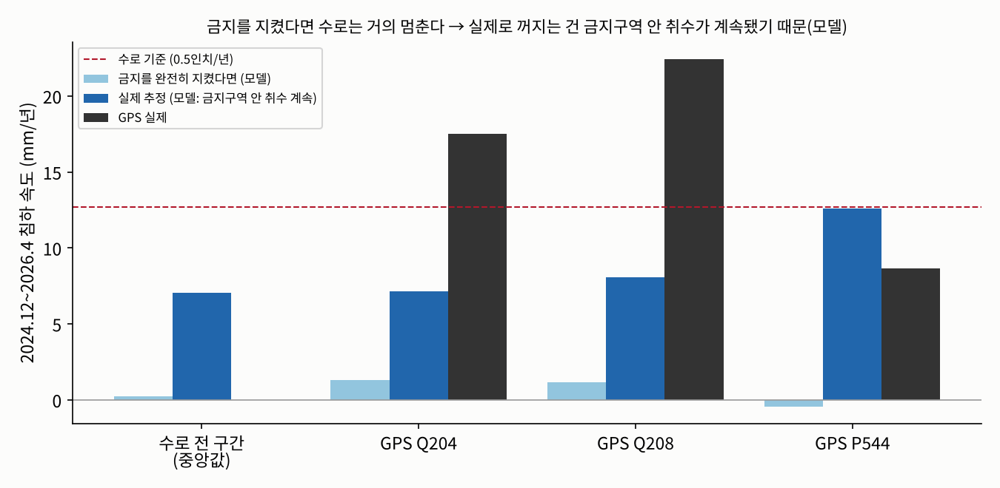

# 응답 검증(자연 실험)과 취수 금지 후 침하 원인

모델 변형 v3, E4 앙상블 30개. 모든 기간이 보정(2015.7~2022.12) 뒤이고, 보정에 GPS를 쓰지 않았다(독립 검증).

## 1. 침하 속도 (mm/년, 아래로 +)

| GPS | 기간 | GPS 관측 | 모델 중앙값 (90% 범위) |
|---|---|---|---|
| P544 | 2020~2022 (가뭄, 배분율 5~20%) | 8.6 | 22.1 (20.5~28.4) |
| P544 | 2023~2024.11 (습한 해, 배분율 40~100%) | -1.4 | 18.9 (16.5~22.6) |
| P544 | 2024.12~2026.4 (취수 금지 후, 배분율 30~50%) | 8.6 | 12.6 (9.4~16.9) |
| Q198 | 2024.12~2026.4 (취수 금지 후, 배분율 30~50%) | 37.8 | 10.7 (8.2~14.9) |
| Q204 | 2023~2024.11 (습한 해, 배분율 40~100%) | 13.0 | 9.5 (8.6~11.6) |
| Q204 | 2024.12~2026.4 (취수 금지 후, 배분율 30~50%) | 17.5 | 7.3 (5.9~9.8) |
| Q208 | 2023~2024.11 (습한 해, 배분율 40~100%) | 18.5 | 10.7 (9.4~13.8) |
| Q208 | 2024.12~2026.4 (취수 금지 후, 배분율 30~50%) | 22.4 | 8.4 (6.6~12.0) |
| Q213 | 2024.12~2026.4 (취수 금지 후, 배분율 30~50%) | 13.7 | 7.8 (6.6~11.3) |

## 2. 취수가 바뀔 때 침하 속도 변화 — 응답 검증

| GPS | 변화 | GPS 관측 | 모델 (90% 범위) | 방향 일치 |
|---|---|---|---|---|
| P544 | 2020~2022 → 2023~2024.11 | -10.1 | -3.5 (-7.7~-1.2) | 예 |
| P544 | 2023~2024.11 → 2024.12~2026.4 | +10.1 | -6.9 (-12.9~-3.2) | 아니오 |
| Q204 | 2023~2024.11 → 2024.12~2026.4 | +4.5 | -2.4 (-4.7~-0.8) | 아니오 |
| Q208 | 2023~2024.11 → 2024.12~2026.4 | +3.9 | -2.4 (-4.9~-0.8) | 아니오 |

4개 변화 중 1개에서 모델이 방향을 맞혔다.

## 3. 2024.12 취수 금지 뒤에도 꺼지는 이유 (2024.12~2026.4, mm/년)

금지구역(수로 양쪽 2.5마일) 농업 취수가 2024.12부터 완전히 멈췄다고 가정하고 모델로 나눴다.

| 위치 | GPS 실제 | 금지 준수 시 모델 | └ 과거 취수로 진행 중인 침하 | └ 금지구역 밖 취수 | 금지 안 했으면 추가 |
|---|---|---|---|---|---|
| 수로 전 구간(지점 중앙값) | - | 0.2 | -5.0 (-6.7~-4.3) | 5.4 (4.6~6.7) | 6.9 |
| GPS P544 | 8.6 | -0.4 | -12.2 (-16.6~-9.8) | 12.2 (10.3~15.2) | 12.1 |
| GPS Q198 | 37.8 | -1.6 | -11.0 (-14.8~-8.9) | 10.0 (8.6~12.3) | 11.5 |
| GPS Q204 | 17.5 | 1.3 | -5.1 (-6.7~-4.3) | 6.4 (5.8~8.2) | 5.9 |
| GPS Q208 | 22.4 | 1.2 | -6.1 (-8.2~-5.0) | 7.3 (6.2~9.4) | 7.1 |
| GPS Q213 | 13.7 | 0.9 | -4.8 (-6.4~-4.1) | 5.8 (5.0~7.9) | 6.3 |

- 모델이 본 실제(금지 후) 수로 침하 연 7.0mm = 과거 취수의 영향 -5.0 (음수면 수위 회복으로 되올라오는 몫) + 금지구역 밖 취수 +5.4 + **금지구역 안에서 계속된 취수 +6.9** (mm/년, 중앙값).
- 금지가 완전히 지켜졌다면 수로 침하는 연 0.2mm로 거의 멈췄을 것이다(모델). 실제로 계속 꺼진다면 금지구역 안 취수가 계속됐거나(아래 '보이지 않는 취수'), 모델이 아직 못 담은 원인이 있다는 뜻이다.
- 관리기관이 할 일: 금지구역 안 미계량 취수 확인 + 금지구역 밖까지 포함한 관정별 배분.
- 한계: 금지가 실제로 얼마나 지켜졌는지(계량 기록)는 비공개다. 2025~26년 수로 물 배분율(50%·30%)이 2023년(100%)보다 낮아 금지구역 밖 취수가 늘었을 수 있다.

계산 시간 1.8분.
