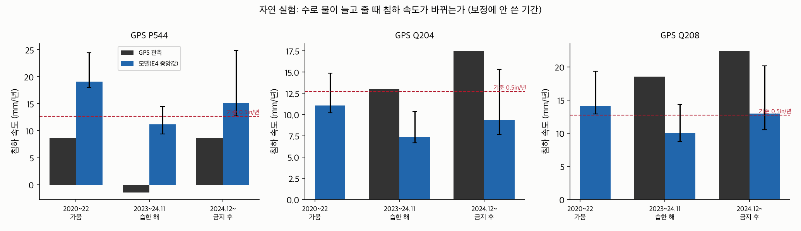

# 응답 검증(자연 실험)과 취수 금지 후 침하 원인

모델 변형 v3ops, E4 앙상블 30개. **운영 모델은 2023~2026 GPS를 보정에 썼으므로 1·2절은 독립 검증이 아니라 적합도다.** 독립 검증은 검증 모델(results_validate_v3)로 말한다.

## 1. 침하 속도 (mm/년, 아래로 +)

| GPS | 기간 | GPS 관측 | 모델 중앙값 (90% 범위) |
|---|---|---|---|
| P544 | 2020~2022 (가뭄, 배분율 5~20%) | 8.6 | 19.1 (18.0~24.5) |
| P544 | 2023~2024.11 (습한 해, 배분율 40~100%) | -1.4 | 11.2 (9.4~14.5) |
| P544 | 2024.12~2026.4 (취수 금지 후, 배분율 30~50%) | 8.6 | 15.1 (12.7~24.9) |
| Q198 | 2024.12~2026.4 (취수 금지 후, 배분율 30~50%) | 37.8 | 17.7 (14.7~29.5) |
| Q204 | 2023~2024.11 (습한 해, 배분율 40~100%) | 13.0 | 7.3 (6.6~10.3) |
| Q204 | 2024.12~2026.4 (취수 금지 후, 배분율 30~50%) | 17.5 | 9.4 (7.6~15.3) |
| Q208 | 2023~2024.11 (습한 해, 배분율 40~100%) | 18.5 | 10.0 (8.7~14.3) |
| Q208 | 2024.12~2026.4 (취수 금지 후, 배분율 30~50%) | 22.4 | 13.0 (10.5~20.2) |
| Q213 | 2024.12~2026.4 (취수 금지 후, 배분율 30~50%) | 13.7 | 11.9 (10.2~20.2) |

## 2. 취수가 바뀔 때 침하 속도 변화 — 응답 검증

| GPS | 변화 | GPS 관측 | 모델 (90% 범위) | 방향 일치 |
|---|---|---|---|---|
| P544 | 2020~2022 → 2023~2024.11 | -10.1 | -8.3 (-10.3~-7.2) | 예 |
| P544 | 2023~2024.11 → 2024.12~2026.4 | +10.1 | +4.8 (+0.9~+11.9) | 예 |
| Q204 | 2023~2024.11 → 2024.12~2026.4 | +4.5 | +2.1 (+0.2~+4.7) | 예 |
| Q208 | 2023~2024.11 → 2024.12~2026.4 | +3.9 | +3.3 (+0.9~+5.7) | 예 |

4개 변화 중 4개에서 모델이 방향을 맞혔다.

## 금지 이후 실제 취수: 위성 침하·GPS로 거꾸로 추정 (운영 모델)

관정별 계량 기록은 비공개다. 운영 모델은 2024.12 이후 취수가 위성 증발산 추정의 몇 배였는지를 GPS 침하로 역산했다.

| 구역 | 위성 추정 대비 실제 취수 배수 (90% 범위) |
|---|---|
| 금지구역 안(수로 양쪽 2.5마일) | 1.36배 (0.99~1.87) |
| 금지구역 밖 | 0.90배 (0.62~1.31) |

1배보다 크면 위성으로 보이는 작물 물 사용보다 더 뽑았다는 뜻이다(미계량·이전 취수, 또는 모델 구조 오차). 관리기관이 현장 확인할 구역을 고르는 근거로 쓴다.

## 3. 2024.12 취수 금지 뒤에도 꺼지는 이유 (2024.12~2026.4, mm/년)

금지구역(수로 양쪽 2.5마일) 농업 취수가 2024.12부터 완전히 멈췄다고 가정하고 모델로 나눴다.

| 위치 | GPS 실제 | 금지 준수 시 모델 | └ 과거 취수로 진행 중인 침하 | └ 금지구역 밖 취수 | 금지 안 했으면 추가 |
|---|---|---|---|---|---|
| 수로 전 구간(지점 중앙값) | - | -0.0 | -5.0 (-6.7~-3.5) | 4.7 (3.5~7.7) | 9.9 |
| GPS P544 | 8.6 | -1.6 | -9.1 (-11.6~-6.3) | 6.8 (5.2~11.8) | 14.9 |
| GPS Q198 | 37.8 | -2.2 | -9.8 (-12.5~-6.8) | 7.2 (5.2~12.1) | 17.3 |
| GPS Q204 | 17.5 | 0.3 | -4.8 (-6.1~-3.4) | 4.9 (3.6~7.8) | 8.1 |
| GPS Q208 | 22.4 | 0.2 | -6.6 (-8.3~-4.6) | 6.6 (4.7~10.4) | 11.2 |
| GPS Q213 | 13.7 | 0.1 | -5.2 (-6.9~-3.7) | 5.2 (3.7~8.2) | 9.9 |

- 모델이 본 실제(금지 후) 수로 침하 연 10.1mm = 과거 취수의 영향 -5.0 (음수면 수위 회복으로 되올라오는 몫) + 금지구역 밖 취수 +4.7 + **금지구역 안에서 계속된 취수 +9.9** (mm/년, 중앙값).
- 금지가 완전히 지켜졌다면 수로 침하는 연 -0.0mm로 거의 멈췄을 것이다(모델). 실제로 계속 꺼진다면 금지구역 안 취수가 계속됐거나(아래 '보이지 않는 취수'), 모델이 아직 못 담은 원인이 있다는 뜻이다.
- 관리기관이 할 일: 금지구역 안 미계량 취수 확인 + 금지구역 밖까지 포함한 관정별 배분.
- 한계: 금지가 실제로 얼마나 지켜졌는지(계량 기록)는 비공개다. 2025~26년 수로 물 배분율(50%·30%)이 2023년(100%)보다 낮아 금지구역 밖 취수가 늘었을 수 있다.

계산 시간 1.6분.
