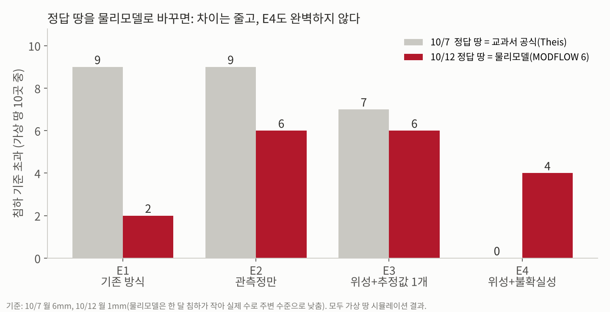

# 합성 대수층 검증 (R2 관문)

참값 파라미터를 알고 있는 가상 대수층에서 모듈 ①(위성 관측으로 지하 상태 추정) → ②(취수 변경 시 미래 계산) → ③(불확실성 반영 취수계획)을 한 번에 연결해 돌린다. 실제 자료 확보 전에 역산이 참값을 복원하는지, E1~E4 비교가 의도대로 나오는지 확인하는 용도다.

## 실행

```bash
pip install numpy scipy
python3 synthetic/run_experiment.py              # 10회 × 앙상블 30, 약 4분
python3 synthetic/run_experiment.py --trials 2 --members 10   # 빠른 확인, 약 20초
```

결과는 `synthetic/results/RESULTS.md`(표)와 `results.json`(원자료)에 저장된다. 최적화는 `demo/optimizer.py`의 `solve`를 그대로 쓴다.

## 구성

| 파일 | 역할 |
|---|---|
| `aquifer.py` | 참값 대수층, 합성 InSAR·관측정 자료 생성, 순방향 모델, 응답 행렬 |
| `calibrate.py` | 역산: E2(수위만), E3(수위+InSAR 단일 추정), E4(RML 앙상블) |
| `run_experiment.py` | 복원 오차 → 검증기간 예측 오차 → 계획 산출 → 참값으로 평가, 실행 불가 테스트 |

## 합성 대수층 설정

| 항목 | 값 |
|---|---|
| 지역 | 6 km × 6 km, 우물 4개·관리지점 3개(데모와 같은 배치), 관측정 4개 |
| 참값 | T = 300 m²/일, S = 0.002, 구역별 Sk = 0.030 / 0.018 / 0.040 / 0.012 |
| 구역 내 불균질 | Sk에 로그정규 공간장 곱함(표준편차 0.25, 상관거리 약 1 km) |
| 취수 이력 | 24개월 월별 취수량, 계절성 + 임의 변동 |
| InSAR | 12일 간격, 500 m 화소 169개, 잡음 3 mm, 화소 10% 결맞음 저하로 결측 |
| 관측정 | 월 1회 수위, 잡음 0.05 m |
| 보정/검증 기간 | 0~540일 보정, 540~720일 검증 |

## 방식

| 방식 | 보정 자료 | 압축성(Sk) | 불확실성 |
|---|---|---|---|
| E1 | 없음 | - | 수요를 우물 용량 비례로 배분 |
| E2 | 관측정 수위 | 문헌 평균값 0.02 하나 | 단일 |
| E3 | 수위 + InSAR | 화소별 추정 | 단일 |
| E4 | 수위 + InSAR | 화소별 추정 | RML 앙상블 30개, 모든 구성원에서 기준 충족(강건 제약) |

침하가 Sk에 선형이므로 화소별 Sk는 닫힌 식으로 풀고 T, S만 비선형 최소제곱으로 찾는다. 그래서 보정 1회가 1초 안팎이다.

## 결과 요약 (10회, 앙상블 30)

- 복원: 위성을 넣으면(E3) 화소별 압축성 오차 중앙값이 41%(E2) → 2.9%로 줄었다. T, S는 두 방식 모두 수 % 이내.
- 예측: 검증기간 InSAR 침하 RMSE가 11.9 mm(E2) → 3.1 mm(E3·E4)로, 관측 잡음(3 mm) 수준이다.
- 계획: 참값 대수층에서 기준 초과 E1 9/10, E2 9/10, E3 7/10, E4 0/10. E4는 E3보다 비용이 약 4% 높다.
- 주의: E3의 초과량은 평균 0.07 mm로 아주 작다. 단일 추정 계획은 기준선에 딱 맞춰 계산되므로 추정이 조금만 낮아도 넘는 것이다. "E3가 크게 위험하다"가 아니라 "단일 추정은 여유가 없다"로 설명해야 한다.
- E4 90% 구간의 참값 포함률은 82%로 목표(90%)보다 낮다. 앙상블이 불확실성을 다소 과소평가한다.
- R2 관문 판단: 합성 자료에서 역산 복원과 최적화 해 산출이 모두 된다 → 통과로 볼 수 있다. 단 물리모델이 해석해라는 조건부.

## 가정과 한계 (발표·문서에 그대로 옮길 때 주의)

- 물리모델은 Theis 해석해 + 선형 탄성 침하다. MODFLOW 6·CSUB가 아니며, 비탄성 압축·지연 배수·경계 조건·다층 구조가 없다. 다음 단계에서 응답 행렬 계산을 MODFLOW로 교체한다.
- InSAR를 수직 변위로 직접 관측한다고 가정했다(LOS 변환, 대기 오차의 공간 상관, 기준점 문제 없음). 그래서 실제보다 InSAR 정보가 깨끗하다.
- 관리지점이 InSAR 화소 위치와 겹친다. 화소 사이 지점은 보간 오차가 추가된다.
- E4 앙상블은 관측 잡음과 사전분포 불확실성만 반영한다. 모델 구조 오차는 반영하지 않으므로 90% 구간이 참값을 90%보다 적게 포함할 수 있다(RESULTS.md 1절 참고).
- 3절의 기준 초과·비용은 실행하지 않은 계획을 참값 모델로 계산한 시뮬레이션 결과다. 2절 예측 오차만 관측으로 확인한 성능이다.

---

## MODFLOW 6 참값 실험 (10/12)

10/7 실험은 정답 땅과 역산 모델이 둘 다 Theis 공식이라 "같은 공식으로 문제를 내고 푼" 셈이었다. 이번에는 **정답 땅을 MODFLOW 6 + CSUB 물리모델로 바꾸고**, 역산·계획 모델(해석해)은 그대로 둔 채 같은 실험을 했다. 실제 땅이 계획 모델보다 복잡한 상황을 시험한 것이다.

### 실행

```bash
pip install numpy scipy flopy matplotlib
get-modflow :flopy                     # MODFLOW 6 실행파일 설치 (Mac·Windows·Linux x86). 또는 MF6_EXE 환경변수로 경로 지정
python3 synthetic/run_experiment.py --truth mf6          # 10회 × 앙상블 30, 약 45분 (MODFLOW 1회 약 5초)
python3 synthetic/run_experiment.py --truth mf6 --trials 1 --members 10   # 빠른 확인, 약 1.5분
python3 synthetic/make_figures_mf6.py                    # 10/7 vs 10/12 비교 그림
```

결과: `synthetic/results_mf6/RESULTS.md`, `results.json`, `fig-compare.png`

### 정답 땅(물리모델)에 새로 들어간 것

| 항목 | 10/7 (Theis) | 10/12 (MODFLOW 6 + CSUB) |
|---|---|---|
| 층 | 1개 | 2개(상부 대수층 50m + 취수 대수층 100m), 층 사이 누수 |
| 경계 | 무한 | 상부층 바깥 경계 수위 고정, 관심 지역 밖 약 7km 완충 격자 |
| 침하 | 수위강하 × Sk (탄성, 선형) | 압축층: 과거 최저 수위(선행압밀수위)보다 내려가면 비탄성(영구) 압축, 그 위는 탄성(비탄성의 1/10) |
| 압축층 저류 | 수위 계산에 없음 | 수위 계산에 반영(수위 변화가 느려짐) |

침하 기준은 월 6mm → **월 1mm**로 바꿨다. 물리모델에서는 압축층 저류 때문에 한 달 추가 침하가 해석해보다 훨씬 작아서 6mm로는 어떤 계획도 기준에 걸리지 않는다. 1mm는 실제 검증 지역 수로 주변 침하 속도(중앙값 15.3mm/년 ≈ 월 1.3mm, `real/README.md`)보다 낮게 관리하는 목표다.



### 결과 요약 (10회, 앙상블 30)

| | E1 기존 | E2 관측정만 | E3 위성 단일 | E4 위성 + 불확실성 |
|---|---|---|---|---|
| 기준 초과(10곳 중) | 2 | 6 | 6 | **4** |
| 초과 시 평균 초과량 | 0.11mm | 0.17mm | 0.13mm | 0.09mm |
| 평균 총비용 | 982만원 | 916만원 | 919만원 | 926만원 |
| 계획 모델 예상 대비 실제 침하 | - | +0.39mm | +0.21mm | +0.02mm |

- **위성의 효과는 그대로다.** 압축성 추정 오차 41.0% → 20.7%, 검증기간 침하 예측 오차 5.14mm → 3.19mm(관측 잡음 3mm 수준).
- **E4가 E2·E3보다 낫지만 완벽하지 않다.** 10/7에는 0/10이었지만 이번에는 4/10이 기준을 넘었다(평균 0.09mm 초과).
- **원인은 계획 모델의 구조 오차다.** 계획 모델(해석해)이 예상한 침하보다 실제 침하가 E2·E3에서는 10번 모두 컸다. 해석해는 "과거 최저 수위 아래로 내려가면 침하가 커지는" 비탄성 압축과 압축층 저류를 모른다. E4 앙상블 90% 구간의 참값 포함률도 57.8%로 낮아(10/7에는 82%), 앙상블이 모델 구조 오차를 담지 못한다.
- **E1이 2/10으로 가장 적게 넘었다.** E1은 우물 용량대로 고르게 뽑아서 한 곳에 몰리지 않기 때문이다. 대신 비용이 가장 높다(982만원). E2~E4는 싼 우물에 몰아 뽑는 계획을 세우는데, 계획 모델이 침하를 작게 보면 그 우물 근처에서 기준을 넘는다.
- 이번 조건에서는 외부 용수 구매가 0이었다(기준이 우물 배분만으로 맞춰지는 수준).

### 이 결과가 말해 주는 다음 할 일

1. 계획 모델을 물리모델 기반으로 바꾼다. MODFLOW를 직접 쓰면 느리므로 **MODFLOW로 학습한 AI 대리모델**을 만든다(기술 설계 3절).
2. 계획 모델이 과거 최저 수위를 알게 한다: 관리 지점 수위가 선행압밀수위(임계수위) 아래로 내려가지 않는 제약 추가.
3. 앙상블에 모델 구조 오차를 포함한다(예: 검증기간 예측 잔차로 여유분 산정).

### 가정과 한계

- 정답 땅은 여전히 가상이다. 층 두께, 누수, 비탄성 비율(10배), 선행압밀수위(초기수위)는 설명용 가정값이다.
- 역산은 해석해로 한다. 물리모델로 역산하는 것은 AI 대리모델 단계에서 다룬다.
- 3절 결과는 시뮬레이션 결과다. 2절 예측 오차만 관측(가상 관측)으로 확인한 성능이다.
